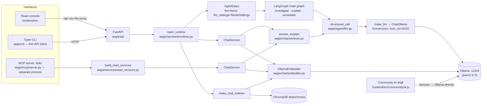
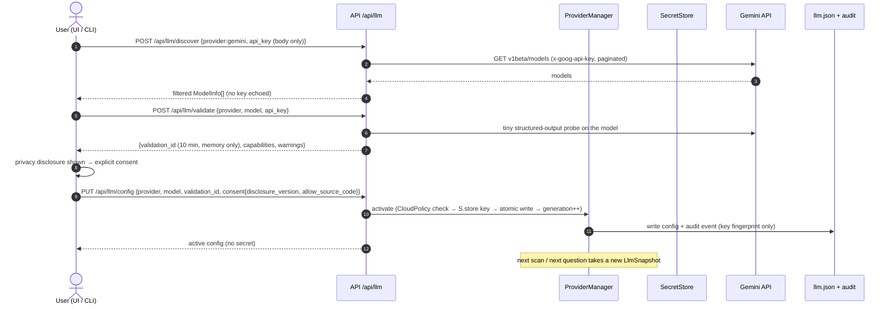
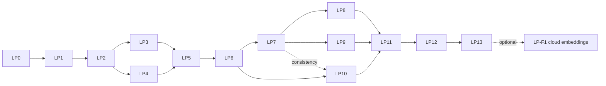

# AEGIS — Multi-Provider LLM Build Plan (`LLM_PROVIDER_PHASES.md`)

**Status:** implemented, LP0–LP13 (2026-10-22/23). Each phase has a dated status note with its real test results. Not committed yet. What still needs the owner is listed at the end of LP12.
**Written:** 2026-10-22, from an inspection of the working tree at HEAD `fc92ed7d` ("project submission").
**Goal:** let the user choose between **Offline mode** (Ollama, `qwen2.5:7b`, the default) and **Online mode** (Google Gemini, a model the user picks, their own API key). Switching the provider must not require rewriting agents, must not change the embedding model or the ChromaDB index, and must not weaken any safety control.

> **Read §2 first.** This feature reverses a recorded project decision ("offline models only", invariant **M-7**). Phase **LP0** asks for explicit sign-off before any code is written.

## Decisions (recorded in LP0, 2026-10-22)

All answers below came from the project owner during LP0. Each one matches the default proposed in §15.

| ID | Decision |
|---|---|
| Q-2 | **M-7′ approved:** offline by default, cloud only by explicit opt-in. The README wording becomes mode-qualified (LP13). |
| Q-1 | `AEGIS_LLM__ALLOW_CLOUD` defaults to **`true`**: Online mode is selectable, but Offline stays the active default. |
| Q-3 | Sending source code to Gemini needs a **separate opt-in, off by default**. Without it, fix drafts in Online mode come from rules only, never from Ollama. |
| Q-4 | **Revised 2026-10-22 (before LP7): the key is asked for every run and kept in memory only, never saved** (no OS keychain). An operator may still provide it through `AEGIS_LLM__GEMINI__API_KEY` or `AEGIS_LLM__GEMINI__API_KEY_FILE`; AEGIS itself never writes it. After a restart, Online mode waits for the key (it runs Offline and says so). Re-entering the **same** key resumes without new consent, because consent is bound to the key's fingerprint; a different key needs consent. *Originally: OS keychain, else env or secret file.* |
| Q-5 | Key display: **fingerprint + last 4 characters**. |
| Q-6 | The Community "AI draft" **stays local (Ollama) in both modes** and is documented as such. |
| Q-7 | Gemini thinking: **the model's default**, configurable with `AEGIS_LLM__GEMINI__THINKING_BUDGET`. |
| Q-8 | The official embedding model is **`bge-m3` (1024)**, and the Ollama URL default becomes **`http://127.0.0.1:11434`**. Both changes land in LP4. Scans S-0017…S-0019 must be reindexed (see F-7). |
| Q-9 | A Gemini key in an editor's MCP `env` block is **documented as discouraged**, a last resort with a plaintext warning. *Since the Q-4 revision:* the MCP server is a separate process and never sees a key typed into the API, so without that env key the MCP `ask` runs Offline and says why. |
| Q-10 | **This plan is tracked in git** (exception added to `.gitignore` in LP0). |
| Q-11 | A running scan **keeps the model it started with**. Only "Go offline" or the kill-switch stops cloud calls mid-scan. |
| Q-12 | "AI unavailable" shows in the **audit, report and health only**. No change to the frozen `ProgressEvent` contract. |

---

## Contents

1. [Scope](#1-scope)
2. [Decision reversal: M-7 "offline models only"](#2-decision-reversal-m-7-offline-models-only)
3. [Current-state architecture (verified)](#3-current-state-architecture-verified)
4. [Repository findings: facts, assumptions, limitations](#4-repository-findings-facts-assumptions-limitations)
5. [Target architecture](#5-target-architecture)
6. [Configuration design](#6-configuration-design)
7. [Gemini integration design](#7-gemini-integration-design)
8. [API design](#8-api-design)
9. [Security and privacy requirements](#9-security-and-privacy-requirements)
10. [Phase map and dependency order](#10-phase-map-and-dependency-order)
11. [The phases in detail](#11-the-phases-in-detail)
12. [Testing strategy](#12-testing-strategy)
13. [Risks and mitigations](#13-risks-and-mitigations)
14. [Final implementation checklist](#14-final-implementation-checklist)
15. [Open questions and repository limitations](#15-open-questions-and-repository-limitations)

---

## 1. Scope

### In scope
- A provider abstraction for **chat or generation LLMs**: one interface, a factory, and two providers (Ollama and Gemini).
- Persisted provider configuration: precedence, safe activation, backward compatibility with `AEGIS_MODEL` / `AEGIS_OLLAMA_URL`.
- Gemini: secure storage of the user's key, dynamic model discovery, validation, error taxonomy, retries, rate limiting.
- Injecting the active provider into every LLM call site: investigate, explain, remediate and RAG chat.
- Separating the **embedding** configuration from the LLM configuration. Embeddings stay local (Ollama `bge-m3` or whatever is configured).
- Every interface: FastAPI, the React console, the Typer CLI and the MCP server (read-only).
- Privacy controls: consent, disclosure, a cloud kill-switch, egress restrictions, secret redaction and an audit trail.
- Tests (unit, integration, regression, E2E for both modes), documentation and packaging.

### Out of scope (initial release)
- **Cloud embeddings.** Listed as an optional future phase (LP-F1). Nothing in the repository requires them (§4, F-9).
- Providers other than Ollama and Gemini. The abstraction allows more later (for example Vertex AI or OpenAI-compatible endpoints), but none are built.
- Changing any deterministic component: scanners, safety controller, correlation, risk engine, claim validator, prompt guard, fix verification.
- LLM token streaming. Nothing streams model tokens today (F-15), so nothing new is added.
- The Community "AI draft" feature in the browser (`frontend/src/community/ai.js`). It stays local-only unless decided otherwise (Q-6).

---

## 2. Decision reversal: M-7 "offline models only"

The repository records a deliberate decision **against** cloud models:

| Where | What it says |
|---|---|
| `MCP_PHASES.md` §5, rule **M-7** | "Offline models only. No cloud-provider code, no API-key setting. The model URL must be a loopback or private-network address." |
| `aegis/safety/model_host.py` | `check_model_url` refuses any public address, with **no override flag** ("so a mistyped or copied config can never send findings to a cloud endpoint"). |
| `aegis/mcp/server.py:21`, `:244` | The MCP server refuses to start if the model URL is not local. |
| `README.md` | "No cloud, no API keys, and your code never leaves your machine." |
| `frontend/src/community/ai.js:1-3` | "No cloud model, no API key." |
| The project's own notes (2026-10-10) | The cloud trade-off was shown and rejected. |

This plan replaces M-7 with **M-7′ "offline by default, cloud only by explicit opt-in"**:

1. A fresh install and an upgraded install behave **exactly** as today: Ollama, no network calls to any model provider.
2. Cloud processing needs **all** of the following:
   - the cloud kill-switch allows it (`AEGIS_LLM__ALLOW_CLOUD`, default `true`; operators can set `false`);
   - a validated key and model;
   - recorded consent to the current disclosure text.
3. The local-only URL guard is **kept** for every Ollama URL (LLM and embeddings). The Gemini provider gets its own fixed endpoint allow-list instead of a configurable URL (§9.4).
4. The README, MCP docs and UI copy must stop saying "your code never leaves your machine" without qualification. They should say "in Offline mode…".

**Sign-off needed (LP0):** confirm M-7′, and whether `ALLOW_CLOUD` should default to `true` or `false` (Q-1).

---

## 3. Current-state architecture (verified)



### 3.1 Every LLM touchpoint (traced with `grep` over `aegis/`, `frontend/src`, `scripts/`)

| # | Location | What it does | Provider coupling |
|---|---|---|---|
| T1 | `aegis/agent/llm.py:57` `make_llm` | **The only place that builds `ChatOllama`** (`format="json"`, `num_ctx`, `temperature`) | Hard, Ollama |
| T2 | `aegis/agent/llm.py:84` `structured_call` | `make_llm(settings).with_structured_output(schema, method="json_schema")`, then validate → one corrective retry → fallback. A transient 5xx is retried once (`_transient` reads `exc.status_code`) | Indirect (T1); `_transient` assumes an Ollama/httpx-shaped error |
| T3 | `aegis/agent/nodes/investigate.py:115` | `NextStepDecision` (next investigation step) | Through T2, `llm=deps.llm`, `settings=deps.llm_settings` |
| T4 | `aegis/agent/nodes/explain.py:116` | `Explanation` (claims, then deterministic claim validation) | Through T2 |
| T5 | `aegis/agent/nodes/remediate.py:392` | `FixEdit` (fix draft). Payload includes **masked handler source** (≤80 lines) | Through T2 |
| T6 | `aegis/chat/retriever.py:165` | `Answer` (cited RAG answer, citation validation) | Through T2, `llm=` / `model_settings=` from `ChatService` |
| T7 | `aegis/chat/embedder.py:39,87` | `OllamaEmbedder` → `POST /api/embeddings` via plain httpx | Hard, Ollama, **uses the LLM's `ollama_url`** |
| T8 | `aegis/chat/indexer.py:68`, `aegis/chat/__main__.py:32,71` | Indexer / reindex CLI build the embedder from `settings.model.ollama_url` | Shares the LLM URL |
| T9 | `aegis/services/runtime.py:96-120` `check_model` | Startup probe `probe_ollama(model.ollama_url, model.name)`, log only | Hard, Ollama |
| T10 | `aegis/services/runtime.py:156,186` | Builds the indexer and `ChatService` with `ollama_url=settings.model.ollama_url` | Shares the URL |
| T11 | `aegis/services/read_services.py:65` | MCP's `ChatService`, same coupling | Shares the URL |
| T12 | `aegis/api/routers/health.py:41,81` | `probe_ollama` → `/api/tags`; `health.ollama` block | Hard, Ollama |
| T13 | `aegis/safety/model_host.py` | Local-only URL guard (M-7); used by `aegis/mcp/server.py:244` and `aegis/mcp/cli.py` doctor | Concept conflicts with cloud |
| T14 | `aegis/mcp/cli.py:31-42,101-133` | `print-config` writes `AEGIS_OLLAMA_URL`/`AEGIS_MODEL`/embed env; `doctor` probes Ollama | Hard, Ollama |
| T15 | `aegis/cli/commands/version.py:44-58`, `aegis/cli/ui/views.py:276-292`, `aegis/cli/ui/menu.py:140` | Show "model … (local, Ollama)", read `health.ollama` | Display only |
| T16 | `frontend/src/App.jsx:46`, `frontend/src/components/Health.jsx:27-33` | Show `health.ollama.reachable/model_present` | Display only |
| T17 | `frontend/src/community/ai.js:6-44` | **Browser calls Ollama `/api/chat` directly**, bypassing the backend | Hard, Ollama, outside the backend |
| T18 | `aegis/config.py:54-76` `ModelSettings` | `name`, `ollama_url` (default `http://ollama:11434`), `temperature`, `num_ctx` | Ollama-shaped settings |
| T19 | `aegis/agent/deps.py:53-55` | `AgentDeps.llm` (a *structured runnable*, tests inject `FakeLLM`) and `llm_settings` | Injection point exists |
| T20 | `scripts/run_local.cmd` | Sets `AEGIS_OLLAMA_URL=http://127.0.0.1:11434` only | Env only |

**Conclusion:** the backend already has a **single chokepoint** (T1/T2). No node instantiates `ChatOllama` directly. The rewrite is small for the LLM. The real coupling is in configuration (T18), embeddings sharing the LLM URL (T7–T11), health/diagnostics (T9, T12, T14–T16), the M-7 guard (T13), and the browser-side Community draft (T17).

---

## 4. Repository findings: facts, assumptions, limitations

### 4.1 Confirmed facts

| ID | Fact | Evidence |
|---|---|---|
| F-1 | All four LLM uses go through `structured_call`; only `make_llm` builds a client. | T1–T6 |
| F-2 | **AEGIS never uses LLM tool or function calling.** The model returns JSON that matches a Pydantic schema (`method="json_schema"`); all tools run deterministically through `SafetyController`. The capability that matters is **schema-constrained JSON output**, not tool calling. | `llm.py:105-109`; no `bind_tools` anywhere |
| F-3 | `AgentDeps.llm` is used **as the structured runnable itself** (`structured_call` calls `llm.ainvoke` directly). Tests pass `FakeLLM`/`PickFirstLLM`, whose `with_structured_output` returns `self`. A real chat model put in `deps.llm` would not work: it would never be bound to the schema. | `llm.py:105-109`, `tests/fakes/fake_llm.py` |
| F-4 | One `AgentDeps` instance is shared by every scan (`JobRunner`) and every fix (`FixService`). It is built once at startup. | `job_runner.py:156`, `fix_service.py:55`, `runtime.py:162` |
| F-5 | Settings are frozen dataclasses read **once** from environment variables at startup. There is no settings persistence layer, and `.aegis.yml` is 0 bytes. | `config.py`, `ls -la` |
| F-6 | The embedder uses the **LLM's** Ollama URL (`settings.model.ollama_url`) everywhere. | T7–T11 |
| F-7 | Defaults disagree. `ChatSettings.embed_model="nomic-embed-text"`/`768` and `ModelSettings.ollama_url="http://ollama:11434"` (Docker hostname), while the README and MCP config use `bge-m3`/`1024` and `127.0.0.1`. `run_local.cmd` does **not** set `AEGIS_CHAT__EMBED_MODEL`, so the API started that way embeds with `nomic-embed-text` (768). An MCP server configured with `bge-m3`/1024 would query the same Chroma collection with 1024-dim vectors. | `config.py:59,128-129`, `run_local.cmd`, README MCP block |
| F-7a | **Measured in LP0 (2026-10-22):**<ul><li>`data/chroma` has 228 vectors, **all 1024-dim** (`bge-m3`): S-0015 has 114 chunks and S-0016 has 114.</li><li>Ollama on this machine has `qwen2.5:7b` and `bge-m3` but **not** `nomic-embed-text`.</li><li>No `AEGIS_*` variable is set at user level.</li><li>**S-0017, S-0018 and S-0019 failed to index**: `config_json.chat_index.error = "EmbeddingUnavailable: could not reach the embedding model 'nomic-embed-text'"`. Chat on the three newest scans has been running on keyword search only.</li></ul>This bug existed before this work; LP4 fixes it. | copy of `data/chroma` and `data/aegis.db` inspected in the scratchpad |
| F-8 | The Chroma collection stores **no** record of the embedding model or dimension. Nothing detects a model or dimension mismatch except Chroma's own dimension error. | `chroma_store.py:41` |
| F-9 | The embedder adds `nomic`-style prefixes (`search_document: ` / `search_query: `) whatever the model is, including `bge-m3`. This is a retrieval-quality quirk, not a blocker, and not caused by this feature. | `embedder.py:23-24` |
| F-10 | When the model is down, nodes **fall back to rules or templates** and the scan continues ("the model being down must never fail the scan"). The failure is logged and recorded as a `fallback` decision, but not surfaced as a clear user-visible status. | `explain.py:125`, `investigate.py:124`, `remediate.py:398`, `retriever.py:168` |
| F-11 | The prompt guard limits what reaches a prompt: whitelisted keys, a 4000-byte budget, no raw evidence. Remediation sends `handler_source`: the user's handler code with comments, docstrings and secret literals masked. Chat sends validated claim text and evidence digests. **In Gemini mode this is what leaves the machine.** | `prompt_guard.py:40-80`, `remediate.py:330-352` |
| F-12 | `structured_call` and `_ainvoke` log `str(exc)[:200]`. A provider exception that echoes a URL or header would land in logs. | `llm.py:49,111` |
| F-13 | API auth is **optional**. Without `AEGIS_API__AUTH_TOKEN` every `/api/*` route is open, which is the local-demo default. There is no CORS middleware (the Vite proxy serves one origin). | `api/security.py`, `vite.config.js` |
| F-14 | `api.schemas`, `evidence.models`, `agent.schemas`, `agent.state` and `safety.models` are **frozen contracts** (`tests/structure/test_st03_contract_freeze.py`). Changing them needs `AEGIS_UPDATE_CONTRACTS=1`, which is the approval step. `Scan.config_json` and `AgentDecision.output_json` are free-form JSON, so provider metadata fits there **without** a contract change. The `/api/health` body is a plain `dict`, not a frozen schema. | test file, `models.py:86,152` |
| F-15 | There is **no LLM token streaming**. Answers use `ainvoke`; the SSE stream (`/api/scans/{id}/events`) carries scan progress only. Cancellation is `asyncio` task cancellation (`JobRunner.cancel`); nodes catch `Exception`, not `CancelledError`, so cancellation propagates. | `job_runner.py`, `events.py` |
| F-16 | The MCP server is a **separate process**, launched by the editor, configured only by environment variables. It opens SQLite read-only and has no access to the API process's memory. | `mcp/server.py:231-253`, `read_services.py` |
| F-17 | The CLI is a thin HTTP client of the API (`RemoteBackend`); `--local` reads the data folder. Commands are registered per module with a `BUILT` set; the plan of record lives in `aegis/cli/commands/planned.py`. Exit codes are defined in `aegis/cli/errors.py` (0/1/2/3/4/5/130). | `cli/main.py`, `planned.py` |
| F-18 | The UI stores the **API bearer token** in `localStorage` (`aegis.token`). This is existing behaviour, not a Gemini key, but it shows the browser is not a secret store. | `frontend/src/api.js:4-22` |
| F-19 | Installed: `langchain-core 1.6.7`, `langgraph 1.2.14`, `langchain-ollama 1.1.0`, `pydantic 2.13.5`, `cryptography 46.0.7`. **Not installed:** `langchain-google-genai`, `google-genai`, `keyring`. | `pip list` |
| F-20 | `.gitignore` ignores `*.md`, so this plan and every other phase document are **untracked**. `data/` (where the config file would live) is ignored too. | `.gitignore` |
| F-21 | The MCP redaction module (`aegis/mcp/redaction.py`) and the logging setup (`aegis/observability.py:111`) exist and can host a global secret-scrubbing processor. | files |
| F-22 | The test suite's default marker filter excludes `ollama`, `docker` and `tools`. The last recorded full run was 1357 passed / 1 skipped (`cli_new_phases.md`, 2026-10-10). **This was not re-run for this plan.** | `pyproject.toml`, notes |

### 4.2 Gemini API facts (from Google's documentation, checked 2026-10-22)

| ID | Fact |
|---|---|
| G-1 | `GET https://generativelanguage.googleapis.com/v1beta/models` lists models. It paginates with `pageSize` (default 50, max 1000) and `pageToken`/`nextPageToken`. `GET /v1beta/models/{model}` returns one model. |
| G-2 | `Model` fields: `name`, `baseModelId`, `version`, `displayName`, `description`, `inputTokenLimit`, `outputTokenLimit`, `supportedGenerationMethods[]` (e.g. `generateContent`), `thinking`, `temperature`, `maxTemperature`, `topP`, `topK`. |
| G-3 | **The model resource has no field for function calling or structured output.** Capability must be inferred (`generateContent` support) **and verified with a live probe**. |
| G-4 | Auth: the REST examples send the key in the **`x-goog-api-key` header**. Some reference samples use `?key=`. AEGIS must use the header, so the key never appears in a URL, proxy log or exception message. |
| G-5 | SDKs read `GEMINI_API_KEY` or `GOOGLE_API_KEY`, and `GOOGLE_API_KEY` wins when both are set. AEGIS must pass the key **explicitly** and never let an SDK pick up an unrelated `GOOGLE_API_KEY` by accident. |
| G-6 | Errors (per the API-errors page): 400 invalid request / failed precondition; **401** missing, invalid or expired key; 402 prepay credit depleted; 403 permission denied; 404 model not found; **429** rate limit / quota exceeded / too many requests; 499 cancelled; 500 internal; 503 unavailable; 504 deadline exceeded. Retry only 408/429/5xx, with exponential backoff. Older responses report a bad key as **400 `INVALID_ARGUMENT` with reason `API_KEY_INVALID`**, so the classifier must accept both shapes. A leaked key is blocked with a specific message. |
| G-7 | `langchain-google-genai` (major version 4.x, built on the `google-genai` SDK) supports `with_structured_output(schema, method="json_schema")` through Gemini's native structured output, and rewrites `$defs`/`$ref`/unions for Gemini. Older 0.x/2.x docs defaulted to `function_calling`. **The exact compatible version with `langchain-core 1.6.7` must be pinned and verified in LP5.** |

### 4.3 Assumptions (to verify in the named phase)

| ID | Assumption | Verify in |
|---|---|---|
| A-1 | `langchain-google-genai` 4.x works with `langchain-core>=1.6.7,<2` and Python 3.10. | LP5.1 |
| A-2 | All four schemas (`NextStepDecision`, `Explanation`, `FixEdit`, `Answer`) convert to Gemini response schemas without loss (enums, `Literal`, optional fields, lists of nested models). | LP5.4 |
| A-3 | `keyring` works on Windows (Credential Manager) and on desktop Linux (Secret Service). Headless Linux and Docker have **no** usable backend. | LP5.2 |
| A-4 | The MCP server process runs as the same OS user as the API, so both can read the same keyring entry. | LP10 |
| A-5 | Gemini's behaviour at temperature 0.1 with structured output is stable enough that the RAG golden eval (`tests/rag/test_rag13_eval.py`) can have an online variant with relaxed thresholds. | LP12 |
| A-6 | The task "investigate" prompt and others produce comparable or better quality on Gemini, so the corrective-retry budget (one retry) is enough. | LP12 |

### 4.4 Repository limitations relevant to this plan
- L-1: No `Dockerfile` or `docker-compose.yml` content (0 bytes), so the "Docker secret" path for the key can only be designed, not tested.
- L-2: The frontend has no component test runner, only `node --test` for pure modules and `vite build`. UI acceptance is partly manual.
- L-3: A `no_network` test guard is referenced in `tests/conftest.py:5` but no implementation was found. LP12 adds a real one.
- L-4: A fresh clone failed 53 tests that pass in the working folder (an earlier note in `CLI_PHASES.md` §3). This is unresolved and may affect the regression baseline.
- L-5: Phase documents are git-ignored (F-20), so this plan does not travel with the repository unless that rule changes (Q-10).

---

## 5. Target architecture

### 5.1 Principles
1. **One chokepoint stays one chokepoint.** `structured_call` stays the only way nodes and chat call a model. Only *how it obtains the model* changes.
2. **Providers are adapters, not branches.** No `if provider == "gemini"` outside `aegis/llm/providers/`.
3. **LLM ≠ embeddings ≠ vector store ≠ reranker.** Four separate settings sections. The reranker (`aegis/chat/reranker.py`) and BM25 (`sparse.py`) are deterministic and stay model-free.
4. **No cross-provider fallback, ever.** If the active provider fails, the existing rule/template fallback runs and the failure is **surfaced**. AEGIS never silently switches between Ollama and Gemini.
5. **Backend is the single source of truth.** UI, CLI and MCP read the same persisted configuration. MCP clients cannot pick their own model.
6. **Pinned per scan, revocable immediately.** A scan records the provider and model it started with. Switching *to* Offline (or flipping the kill-switch) stops cloud calls at once, even for a running scan.

### 5.2 Target component view

```mermaid
flowchart TB
  subgraph Interfaces
    UI[React · AI settings page]
    CLI[CLI · aegis llm …]
    MCP[MCP · llm_status tool + aegis://config/llm resource, read-only]
  end
  UI & CLI -->|/api/llm/*| API[FastAPI · routers/llm.py]
  API --> PM[ProviderManager<br/>aegis/llm/manager.py]
  MCP --> PMR[ProviderManager, read-only<br/>reloads config file on change]
  PM --> CFG[(data/config/llm.json<br/>non-secret, atomic, versioned)]
  PM --> SEC[SecretStore<br/>aegis/llm/secrets.py<br/>env → OS keyring]
  PM --> POL[CloudPolicy<br/>kill-switch · consent · egress allow-list]
  PM --> REG[ProviderRegistry]
  REG --> OP[OllamaProvider<br/>ChatOllama, local-URL guard]
  REG --> GP[GeminiProvider<br/>ChatGoogleGenerativeAI, header auth,<br/>discovery · probe · limiter · breaker]
  subgraph Agent
    SC[structured_call] -->|provider.structured(schema)| PM
    N1[investigate] & N2[explain] & N3[remediate] --> SC
  end
  CHAT[ChatService · answer_explain] --> SC
  CHAT --> EMB[Embedder · EmbeddingSettings<br/>Ollama bge-m3, unchanged] --> CH[(ChromaDB + index manifest)]
  AUD[(audit/llm.jsonl)] 
  PM --> AUD
```

### 5.3 Provider interface (sketch, to be finalised in LP2)

```python
# aegis/llm/base.py
class ProviderId(str, Enum):
    ollama = "ollama"
    gemini = "gemini"

@dataclass(frozen=True)
class ModelInfo:            # what discovery returns; safe to show anywhere
    provider: ProviderId
    id: str                 # e.g. "qwen2.5:7b" or a Gemini baseModelId
    display_name: str
    input_token_limit: int | None
    output_token_limit: int | None
    thinking: bool | None
    stage: Literal["stable", "preview", "experimental", "unknown"]
    capabilities: frozenset[str]   # {"generate", "structured_output"} - "structured_output" only after a probe

@dataclass(frozen=True)
class LlmSnapshot:          # immutable, pinned per scan / per question
    provider: ProviderId
    model: str
    location: Literal["local", "cloud"]
    generation: int         # bumps on every activation; used for revocation checks
    options: Mapping[str, Any]     # temperature, timeouts, provider-specific (num_ctx, thinking_budget)

class LlmProvider(Protocol):
    id: ProviderId
    location: Literal["local", "cloud"]
    def structured(self, snapshot: LlmSnapshot, schema: type[BaseModel]) -> Runnable: ...
    async def list_models(self, credential: Secret | None) -> list[ModelInfo]: ...
    async def validate(self, model: str, credential: Secret | None) -> ValidationResult: ...
    async def health(self, snapshot: LlmSnapshot) -> ProviderHealth: ...
    def classify(self, exc: BaseException) -> LlmError: ...   # maps SDK errors to the AEGIS taxonomy
```

`LlmError` is one taxonomy for both providers (§7.5). `structured_call` keeps its signature and behaviour. Internally:

```python
structured = llm if llm is not None else manager.structured(schema, snapshot=snapshot)  # was make_llm(settings).with_structured_output(...)
```

`make_llm(settings)` stays as a thin, deprecated wrapper over `OllamaProvider` for backward compatibility. Tests and scripts that import it keep working.

### 5.4 Provider-selection data flow



### 5.5 Per-scan pinning and revocation

- At scan start (`prepare` node, `aegis/agent/nodes/prepare.py:91-99`), the current `LlmSnapshot` (provider, model, location, generation, `allow_source_code`) is written into `Scan.config_json["llm"]`. **No contract change** (F-14).
- Each `structured_call` from a node resolves the snapshot for its `scan_id`, then asks `ProviderManager.authorize(snapshot)`:
  - The snapshot's provider is **local**: allowed, even if the active provider has since become Gemini (the scan keeps its model).
  - The snapshot's provider is **cloud**: allowed only while cloud is still active, consent is still valid and the kill-switch is still open. Otherwise it raises `LlmError(kind="revoked")`, and the node falls back to rules or templates exactly as for an outage, recording `error="cloud processing revoked"`.
- Fix drafting (`FixService`, a separate graph) re-resolves the snapshot from the finding's scan, so the same rules apply.
- Chat (`/api/ask`, MCP `ask`) uses the **active** snapshot at question time, not the scan's. The question is processed now, so current consent governs it.
- Each LLM decision records `{"provider", "model", "location"}` in `AgentDecision.input_summary_json` (free-form, no contract change), so the audit shows which model produced what.

---

## 6. Configuration design

### 6.1 Settings sections (new names; old names stay as aliases)

| Section | Purpose | Key settings (env) | Default |
|---|---|---|---|
| `llm` | Which provider is active, kill-switch, shared behaviour | `AEGIS_LLM__PROVIDER` (`ollama`\|`gemini`), `AEGIS_LLM__ALLOW_CLOUD`, `AEGIS_LLM__TIMEOUT_S`, `AEGIS_LLM__TEMPERATURE` | `ollama`, `true` (Q-1), `120`, `0.1` |
| `llm.ollama` | Local chat model | `AEGIS_MODEL` / `AEGIS_MODEL__NAME`, `AEGIS_OLLAMA_URL` / `AEGIS_MODEL__OLLAMA_URL`, `AEGIS_MODEL__NUM_CTX` | `qwen2.5:7b`, `http://ollama:11434` (Q-8), `8192` |
| `llm.gemini` | Cloud chat model (non-secret part) | `AEGIS_LLM__GEMINI__MODEL`, `AEGIS_LLM__GEMINI__RPM`, `AEGIS_LLM__GEMINI__THINKING_BUDGET`, `AEGIS_LLM__GEMINI__MAX_OUTPUT_TOKENS` | unset, `10`, unset, `2048` |
| secret | Gemini key | `AEGIS_LLM__GEMINI__API_KEY` (env), else OS keyring entry `aegis/gemini-api-key` | none |
| `embeddings` (**new, split from `chat`**) | Embedding provider | `AEGIS_CHAT__EMBED_MODEL`, `AEGIS_CHAT__EMBED_DIM` (kept), **`AEGIS_CHAT__EMBED_URL`** (new; default = the Ollama URL in effect) | `ollama`, as today |
| `chat` (vector store and retrieval) | Chroma path, collection, k values, budgets | unchanged | unchanged |

`ModelSettings` stays, as the Ollama section, so every existing reference (`settings.model.name`, `settings.model.ollama_url`) keeps working. New code reads `settings.llm`.

### 6.2 Precedence (highest first)

1. **Environment variables.** If `AEGIS_LLM__PROVIDER` (or `AEGIS_LLM__GEMINI__MODEL`) is set, that field is **managed by the environment**. The API reports it as `managed_by: "env"` and refuses to change it (HTTP 409 `managed_by_environment`). This is for CI and Docker.
2. **Persisted config file** `<data_dir>/config/llm.json`, written only by the API (and the CLI via the API).
3. **Built-in defaults**, which equal today's behaviour.

`AEGIS_LLM__ALLOW_CLOUD=false` is absolute. It overrides the file and makes Gemini un-activatable. The UI hides or disables Online mode with the reason.

### 6.3 Persisted file `<data_dir>/config/llm.json` (non-secret only)

```json
{
  "schema_version": 1,
  "generation": 7,
  "provider": "gemini",
  "ollama": {"model": "qwen2.5:7b"},
  "gemini": {
    "model": "<baseModelId chosen by the user>",
    "validated_at": "2026-10-22T10:00:00Z",
    "capabilities": ["generate", "structured_output"],
    "key_ref": {"source": "keyring", "fingerprint": "sha256:3f9a…c21e", "last4": "…Xk9Q"}
  },
  "consent": {
    "disclosure_version": "2026-10-22.1",
    "accepted_at": "2026-10-22T10:00:05Z",
    "accepted_via": "ui",
    "allow_source_code": false
  },
  "updated_at": "2026-10-22T10:00:05Z"
}
```

- **Atomic writes:** write `llm.json.tmp`, `fsync`, then `os.replace`. A partial write can never be read. On any parse or validation failure, the manager **fails closed to Offline** and reports `config_error`. It never "best-guesses" Gemini.
- File permissions: owner-only where the OS supports it (`0600` on Linux). On Windows, the file sits in the user's data folder, and it contains no secret anyway.
- Pydantic model `LlmConfigFile` with `extra="forbid"` validates on read. An unknown `schema_version` is treated as a config error, which means Offline.
- `last4` is **optional** (Q-5). The fingerprint is `sha256(key)` truncated, which is enough to tell keys apart and useless to an attacker.

### 6.4 Backward compatibility
- No file and no new env variables gives provider `ollama` with today's `ModelSettings`. Identical behaviour, and **no** Gemini code is imported (the extra may not even be installed).
- `make_llm(settings)` stays (deprecated) and returns the same `ChatOllama`.
- `/api/health` keeps its `ollama` block byte-compatible. New `llm` and `embeddings` blocks are added beside it.
- MCP `print-config` output stays valid. New installs add no secret to it.

---

## 7. Gemini integration design

### 7.1 Library choice
- **Generation:** `langchain-google-genai` 4.x, `ChatGoogleGenerativeAI(model=…, google_api_key=<explicit>, temperature=…, max_output_tokens=…, timeout=…, max_retries=0)`. Use `with_structured_output(schema, method="json_schema")`. LangChain retries are turned **off** (`max_retries=0`); AEGIS's own retry policy (§7.5) is the only one, so attempts are counted and audited once.
- **Discovery and validation:** a small **httpx** client (`aegis/llm/providers/gemini_rest.py`) calls `GET /v1beta/models` with the `x-goog-api-key` header. Owning this call keeps the key out of URLs, gives exact control of pagination, timeouts and error mapping, and makes it trivial to test with `httpx.MockTransport`. This is the same pattern as `OllamaEmbedder` and `probe_ollama`.
- Packaged as an **optional extra** `gemini` (`pip install -e ".[gemini]"`), so the offline install footprint is unchanged. If the extra is missing, `GET /api/llm/providers` reports Gemini as `installed: false` with the install hint.

### 7.2 Dynamic model discovery and filtering (no hard-coded list)

1. Page through `GET /v1beta/models?pageSize=1000` (follow `nextPageToken`; stop after 10 pages as a safety bound).
2. **Keep** a model only if `"generateContent" in supportedGenerationMethods`.
3. **Drop** models whose `name`/`baseModelId`/`description` mark them as non-text-generation families. This deny-list is configurable (`AEGIS_LLM__GEMINI__EXCLUDE_PATTERNS`), not a model allow-list: embedding, AQA, image, video, TTS/audio-native, live/realtime, robotics. It is a heuristic, which is why step 5 exists.
4. **Drop** models with `inputTokenLimit < 16384`. AEGIS prompts are at most about 4 KB (prompt guard) plus a 3000-token chat context, plus output.
5. **Label, don't hide:** `stage` (`preview`/`experimental` from the name or description, else `stable`), `thinking`, token limits. The UI sorts stable models first.
6. Capability `structured_output` is added **only** after a validation probe succeeds (§7.3). Until then the model shows as "not yet verified".
7. Cache the list in memory per key fingerprint for 10 minutes. Never write it to disk with the key.

**Tool calling** is not a requirement (F-2), so models are not filtered on it. If a future feature needs tool calling, `validate` gains a second probe with a dummy function declaration. The interface already has a `capabilities` set for this.

### 7.3 Validation (before activation)
`validate(model, key)`:
1. `GET /v1beta/models/{model}`. 401 or `API_KEY_INVALID` → `invalid_api_key`. 403 → `permission_denied`. 404 → `model_not_found`.
2. **Probe:** one `structured(…, schema=_Probe)` call (`class _Probe(BaseModel): ok: bool; echo: Literal["aegis"]`) with a fixed, non-sensitive prompt and `max_output_tokens=64`. A pass proves the key works, the model generates, and schema-constrained output parses.
3. **Optional deep probe** (`?deep=true`): run each of the four real schemas with a synthetic, non-sensitive payload from `tests/fixtures`. This catches A-2 issues before a real scan.
4. Return `ValidationResult{ok, capabilities, warnings[], validation_id}`. `validation_id` maps to the **candidate key held in memory only**, expires after 10 minutes, and is single-use.

### 7.4 Generation options mapping

| AEGIS option | Ollama | Gemini |
|---|---|---|
| temperature (0.1) | `temperature` | `temperature` (clamped to the model's `maxTemperature`) |
| JSON constraint | `format="json"` + `json_schema` | native `response_schema` via `json_schema` |
| context size | `num_ctx=8192` | n/a (uses `inputTokenLimit`) |
| output bound | — | `max_output_tokens` (default 2048) |
| thinking | — | `thinking_budget` when the model reports `thinking: true` (Q-7) |
| timeout | client default | `timeout=AEGIS_LLM__TIMEOUT_S` |

### 7.5 Error taxonomy, retries, rate limiting

`LlmError.kind`, shared by both providers and mapped by `provider.classify(exc)`:

| kind | Typical cause (Gemini / Ollama) | Retry? | Effect |
|---|---|---|---|
| `invalid_api_key` | 401, or 400 `API_KEY_INVALID`, or "reported as leaked" | no | **Breaker opens** for this snapshot; UI/CLI show "key invalid — re-enter" |
| `permission_denied` | 403 | no | Breaker opens |
| `billing_required` | 402, 400 `FAILED_PRECONDITION` (billing) | no | Breaker opens |
| `model_not_found` | 404 / Ollama 404 "model not found" | no | Breaker opens; "pick another model" or "`ollama pull …`" |
| `quota_exhausted` | 429 daily quota | no (until reset) | Breaker opens; shows reset hint |
| `rate_limited` | 429 per-minute | yes, honouring `Retry-After`, else 2 s → 4 s (2 retries, jitter) | — |
| `unavailable` | 503 / 500 / 504 / connection error / Ollama down | yes (as above) | After retries, the call fails and the node falls back |
| `timeout` | client timeout / 408 | yes, once | — |
| `invalid_request` | 400 other (e.g. schema rejected) | no | Recorded; the node falls back (one corrective retry still applies to *output* errors in `structured_call`) |
| `revoked` | consent withdrawn / switched to Offline / kill-switch | no | Node falls back with `cloud processing revoked` |
| `cancelled` | task cancelled | — | `CancelledError` propagates (unchanged) |

- **Circuit breaker:** per `(scan_id or "chat", snapshot.generation)`. A non-retryable error opens it, so later findings in the same scan skip the provider immediately, which avoids 200 identical 401s. It is recorded **once** as a decision and a log event.
- **Client-side rate limiter:** a token bucket per provider (`AEGIS_LLM__GEMINI__RPM`, default 10) shared by scans and chat in one process, so a scan does not drain a free-tier quota.
- `_transient()` in `llm.py` is replaced by `provider.classify(exc).retryable`, so Ollama keeps its current "one retry on 5xx" behaviour.

### 7.6 "Never silently fall back"
- **Offline mode:** no Gemini object is constructed, and the Gemini module is not imported. The `CloudPolicy` refuses any cloud snapshot. If Ollama is down, behaviour is today's (rules or templates), **plus** a visible status (LP3.6). It never switches to Gemini.
- **Online mode:** if Gemini fails, the node falls back to rules or templates. It does **not** switch to Ollama, because the user's choice of model must be honoured in both directions.

---

## 8. API design

All new routes live in **`aegis/api/routers/llm.py`** (prefix `/api/llm`, tag `llm`). Request and response models live in a **new module `aegis/api/llm_schemas.py`**, so the frozen `aegis/api/schemas.py` contract (F-14) is untouched. Errors use the existing `ErrorOut` (`{error, detail, ids}`) with new `error` strings, so no contract change is needed.

### 8.1 Routes

| Method & path | Purpose | Mutates? | Notes |
|---|---|---|---|
| `GET /api/health` (**extended**) | Adds `llm` and `embeddings` blocks; keeps `ollama` | no | `llm: {provider, model, location, ready, reason, managed_by}`. In Gemini mode it does **not** call Gemini (no cost); `ready` comes from the last validation and breaker state |
| `GET /api/llm/providers` | Supported providers and whether each is installed, allowed (kill-switch) and configured | no | Static plus checks |
| `GET /api/llm/config` | Active config, **no secret** | no | `key: {configured, source, fingerprint, last4?}`, consent, `generation`, `managed_by` |
| `GET /api/llm/models?provider=ollama` | Local models (Ollama `/api/tags`) | no | Reuses `probe_ollama` |
| `POST /api/llm/discover` | Gemini models for a **candidate** key (in the body) or the stored key (body omits `api_key`) | no | POST so the key is never in a URL |
| `POST /api/llm/validate` | Validate provider, model and key; returns `validation_id` | no (memory only) | `deep: bool` option |
| `PUT /api/llm/config` | **Activate** a configuration | **yes** | Gemini needs `validation_id` and `consent`; Ollama needs only `model` |
| `DELETE /api/llm/credentials/gemini` | Forget the stored key | **yes** | If Gemini is active, it first switches to Offline (audited) |
| `POST /api/llm/test` | One probe on the **active** provider | no (costs one call) | Rate-limited: 1 per 10 s |

`PUT /api/llm/config` with `{"provider":"ollama"}` is the **one-step "go offline"**. It never needs a key or consent and takes effect immediately (§5.5 revocation).

### 8.2 Schemas (sketch)

```python
class DiscoverRequest(BaseModel):
    provider: Literal["gemini"]
    api_key: SecretStr | None = Field(None, min_length=20, max_length=200)  # omitted → stored key

class ModelOut(BaseModel):
    id: str; display_name: str; stage: str; thinking: bool | None
    input_token_limit: int | None; output_token_limit: int | None; capabilities: list[str]

class ValidateRequest(BaseModel):
    provider: Literal["ollama", "gemini"]; model: str = Field(pattern=r"^[A-Za-z0-9._:/-]{1,128}$")
    api_key: SecretStr | None = None; deep: bool = False

class ValidateOut(BaseModel):
    ok: bool; validation_id: str | None; capabilities: list[str]; warnings: list[str]
    disclosure: DisclosureOut | None   # text + version, so UI and CLI show the same words

class ConsentIn(BaseModel):
    disclosure_version: str; accepted: Literal[True]; allow_source_code: bool = False

class ActivateRequest(BaseModel):
    provider: Literal["ollama", "gemini"]; model: str
    validation_id: str | None = None; consent: ConsentIn | None = None

class LlmConfigOut(BaseModel):
    provider: str; model: str | None; location: Literal["local", "cloud"]; generation: int
    managed_by: Literal["file", "env", "default"]; allow_cloud: bool
    key: KeyStatusOut | None; consent: ConsentOut | None
    embeddings: EmbeddingStatusOut   # always shown: "embeddings stay local"
```

`SecretStr` keeps the key out of `repr`, logs and validation-error messages. The 422 handler in `aegis/api/errors.py` must also be checked so it never echoes `input` for these fields (LP7.4).

### 8.3 Error responses

| HTTP | `error` | When |
|---|---|---|
| 401 | `unauthorized` | Existing bearer check (unchanged) |
| 403 | `cloud_disabled` | `AEGIS_LLM__ALLOW_CLOUD=false` |
| 403 | `config_api_forbidden` | Mutating request without a token from a non-loopback client, or missing the anti-CSRF header (§9.6) |
| 409 | `managed_by_environment` | The field is pinned by env |
| 409 | `consent_required` | Gemini activation without valid consent for the current `disclosure_version` |
| 410 | `validation_expired` | `validation_id` unknown, used or expired |
| 422 | `invalid_api_key` · `model_not_found` · `model_unsupported` · `invalid request` | Upstream rejections and validation failures (422, not 401, so the UI can't confuse them with AEGIS's own auth) |
| 429 | `provider_rate_limited` / `provider_quota_exhausted` | With `Retry-After` when known |
| 502 | `provider_error` | Upstream 5xx after retries |
| 503 | `provider_unreachable` | Network or DNS error, Ollama down |
| 501 | `not available` | The Gemini extra is not installed (existing `NotAvailable` mapping) |

### 8.4 Lifecycle: no restart needed
- `ProviderManager` lives on `Runtime` (`aegis/services/runtime.py`) and `app.state`, and is put on `AgentDeps` as `llm_manager`. `AgentDeps.llm` stays for test injection (F-3).
- Activation bumps `generation`. Snapshots are cheap value objects, and chat-model clients are built lazily per snapshot and cached by `(provider, model, generation)`. **No graph rebuild and no worker restart.** Running scans keep their pinned snapshot (§5.5).
- The MCP process (separate, F-16) re-reads `llm.json` when its mtime changes, checked before each `ask`.

---

## 9. Security and privacy requirements

### 9.1 What leaves the machine in Online mode (the disclosure must say this plainly)

| LLM task | Payload sent to Google (built by `prompt_guard.build_payload`) |
|---|---|
| investigate | Finding type, OWASP class, title, route, function, **file path and line**, scores, evidence IDs, **evidence digests**, the valid next steps |
| explain | The same, plus the scan mode |
| remediate | All of the above **plus up to 80 lines of the user's handler source code** (comments, docstrings and secret literals masked) and the fix hint |
| chat (`ask`) | The **user's question**, plus up to 5 retrieved findings' validated text (what, impact, exploit, fix, where) and evidence digests |

Never sent (guaranteed by the existing prompt guard, unchanged): raw HTTP requests or responses, raw evidence payloads, full files, secret values, identities or credentials from `identities.yml`, the database, the Chroma index, embeddings.

**Disclosure text (draft; versioned `disclosure_version`):**
> "Online mode sends parts of your security findings to Google's Gemini API: vulnerability descriptions, file paths, routes, evidence summaries, your chat questions and, if you allow it, short excerpts of your source code. Google processes this under the terms of *your* API key and account. This is not offline, and AEGIS cannot control how Google stores or uses the data. Embeddings and the search index stay on this machine. Switch back to Offline at any time; it takes effect immediately."

Never claim that Online mode is offline, private or "secure because data stays local".

### 9.2 Consent
- Consent is required to **activate** Gemini, and is **re-required** when the disclosure text version changes, after the key changes, or after the kill-switch has been used.
- **Source-code consent is separate** (`allow_source_code`, default **false**, Q-3). Without it, the remediate node does **not** call Gemini. It records `fallback` with reason `source code not shared with cloud provider (consent)`, so fix drafts come from rules only (secrets and dependency upgrades). It does **not** use Ollama instead (§7.6).
- The CLI shows the same text and needs an explicit `--accept-cloud-disclosure <version>` for non-interactive use, or an interactive "type YES".
- Starting a scan while Online shows a one-line notice in the UI (New scan page) and the CLI (`scan run`, beside the existing authorisation note): "AI processing: Gemini <model> (online) — findings will be sent to Google".

### 9.3 Credential storage, redaction, rotation
- **Storage order:** env `AEGIS_LLM__GEMINI__API_KEY`, then OS keyring (`keyring` library: Windows Credential Manager, macOS Keychain, Linux Secret Service). **No plaintext file fallback by default.** On a headless host without a keyring backend, the key must come from the env (or a Docker secret file via `AEGIS_LLM__GEMINI__API_KEY_FILE`), and the API returns 409 `secret_store_unavailable` with that hint (Q-4).
- The key is **never** stored in `llm.json`, SQLite, Chroma, checkpoints (`data/checkpoints.db`), reports, audit records, `Scan.config_json`, the frontend or MCP output. It is never passed to `AgentDeps` or graph state: providers fetch it from `SecretStore` at client build time.
- **Redaction**, in three layers:
  - A `SecretStr` type at the API boundary.
  - A structlog processor in `aegis/observability.py` that replaces (a) the exact active and candidate key values (registered with a process-wide `SecretRegistry`) and (b) the Google key pattern `AIza[0-9A-Za-z_\-]{35}` in every log event and every exception string.
  - `structured_call`'s `str(exc)[:200]` (F-12) goes through the same scrubber.
- The same scrubber is applied to `aegis/mcp/redaction.py` output and to `AgentDecision.error` before storage.
- **Rotation:** validate the new key, then activate (which replaces the keyring entry atomically, keeping the old one until the new one is written), then audit `key_rotated` (old and new fingerprints). `DELETE /api/llm/credentials/gemini` removes it.
- **Least privilege:** the docs recommend a dedicated key restricted to the Generative Language API, with billing alerts (Google's own guidance).

### 9.4 Egress
- The Gemini provider reaches **only** `generativelanguage.googleapis.com:443` over HTTPS with certificate verification. The host is a constant, not a user setting. This egress is **separate** from the scan allow-list (`AEGIS_SAFETY__ALLOWLIST`), which is for scan targets and is never widened by this feature.
- The httpx clients used by AEGIS's own Gemini code get a transport guard that refuses any other host (mirrors `aegis/safety/egress.py`). The LangChain/SDK client is configured with the base URL constant. Proxies come from the standard `HTTPS_PROXY` (documented).
- `check_model_url` (M-7 guard) keeps applying to `llm.ollama.url` **and** the new `embeddings` URL, so embeddings can never be pointed at a public host by accident (§4 Embedding rules).

### 9.5 Offline mode can't make cloud calls
- `CloudPolicy.allows_cloud()` is false unless provider = gemini, the kill-switch is open, consent is valid and the key is present.
- The Gemini module is imported lazily, only by `GeminiProvider`, which the registry builds only when allowed.
- Test guard (LP12): with the provider set to `ollama`, a socket-level guard fails the test on any connection to a non-loopback address, and an import hook asserts `langchain_google_genai` and `google.genai` were never imported.

### 9.6 Protecting the configuration endpoints (F-13: the API may be unauthenticated)
- With `AEGIS_API__AUTH_TOKEN` set, the existing bearer middleware protects the `/api/llm/*` routes.
- Without a token, **mutating** `/api/llm/*` routes are accepted only when:
  - the client address is loopback, **and**
  - the request carries `X-AEGIS-Intent: llm-config`. A custom header forces a CORS preflight; with no CORS middleware the preflight fails, so a malicious web page cannot drive these endpoints from the user's browser.
  - Also check `Origin`/`Sec-Fetch-Site` when present.
- The README already warns to scan only authorised targets. It must also warn: **do not expose the API beyond loopback without a token**, because the key-configuration routes would be exposed.
- The `/api/llm/discover` and `/validate` bodies (which hold a candidate key) stay within the existing 64 KB body limit, and the request log never includes bodies (it doesn't today).

### 9.7 Audit (no secrets)
`<data_dir>/audit/llm.jsonl`, append-only, in the same style as `aegis/mcp/audit.py`. One line per event: `provider_activated`, `provider_deactivated`, `key_stored`, `key_rotated`, `key_deleted`, `consent_granted`, `consent_revoked`, `validation_failed` (kind only), `breaker_opened`, `cloud_blocked_by_policy`. Fields: `at`, `actor` (`ui`/`cli`/`env`), client address, `generation`, provider, model, key **fingerprint**. Tests assert the sentinel key never appears in the file.

### 9.8 Safety controls that must not change
Scope enforcement (`SafetyController`, allow-list, rate limiter), the prompt guard (whitelist and byte budget; no new keys for Gemini), claim validation (`aegis/agent/validator.py` and `validate_claims`), citation validation in chat, the RAG scope gate, evidence states (the LLM never creates or edits findings), human approval for fixes, `git apply --check` plus re-verification. **Provider choice only replaces which model writes the JSON; every check before and after the call stays the same.** LP3 adds a regression test per control.

### 9.9 Model output vs verified findings
Unchanged rule: findings and their states come only from deterministic workers and the state machine. Model output is explanation, suggestion or draft. New: the UI, report and CLI label LLM-authored text with its provider and model ("Explanation written by Gemini <model> (online)" / "…qwen2.5:7b (local)"), using the decision records from §5.5.

---

## 10. Phase map and dependency order

| Phase | Title | Depends on | User-requested area |
|---|---|---|---|
| **LP0** | Decisions, sign-off, baseline | — | 1 |
| **LP1** | Repository audit lock-in and guard tests | LP0 | 1 |
| **LP2** | Provider abstraction, configuration and persistence (Ollama only) | LP1 | 2 |
| **LP3** | Agent and chat integration through the provider (Ollama only, regression gate) | LP2 | 5 |
| **LP4** | Embedding and RAG decoupling and compatibility | LP2 | 9 |
| **LP5** | Gemini provider: credentials, discovery, validation, errors | LP3, LP4 | 3 |
| **LP6** | Core privacy controls: consent, kill-switch, egress, redaction, audit | LP5 | 10 (core) |
| **LP7** | FastAPI provider management | LP6 | 4 |
| **LP8** | React UI | LP7 | 6 |
| **LP9** | CLI | LP7 | 7 |
| **LP10** | MCP server | LP6 (LP7 for consistency tests) | 8 |
| **LP11** | Security hardening and review | LP8, LP9, LP10 | 10 (hardening) |
| **LP12** | Integration, regression and E2E testing (both modes) | LP11 | 11, 9 (validation) |
| **LP13** | Documentation, migration, packaging, release | LP12 | 12 |
| LP-F1 | *(future, optional)* Cloud embeddings | LP13 | — |



**Why this order differs from the requested numbering:**
- Agent integration (LP3) comes **before** Gemini (LP5). Rerouting the chokepoint through the abstraction with Ollama only can be proven regression-free on its own.
- Embedding decoupling (LP4) also comes before Gemini, because switching the LLM must not move the embedding URL (F-6).
- Core privacy controls (LP6) come **before** any interface exposes Gemini. A final hardening review (LP11) follows the interfaces.

**Gates:** after every phase, the full default suite stays green (`.venv\Scripts\python.exe -m pytest -q`). After LP3, LP4 and LP12, also run `-m ollama` (real local model) and `-m tools` where available. Results are recorded in the phase's "Done" note, **with real numbers only**.

---

## 11. The phases in detail

Conventions: **paths are real repository paths**; "new" marks files to create. Every phase ends with the gate in §10.

---

### LP0: Decisions, sign-off, baseline

**Objective:** agree on the decision reversal and the open defaults, and record a trustworthy test baseline before touching code.

**Inspect:** `MCP_PHASES.md` §5 (M-7) and Appendix C (C33, C36), `README.md`, `aegis/safety/model_host.py`, `tests/structure/test_st03_contract_freeze.py`.

**Tasks**
- [ ] Get sign-off on M-7′ (§2) and answers to Q-1…Q-10 (§15). Record them in a "Decisions" table at the top of this file.
- [ ] Run the full default suite on the current HEAD; record pass, fail and skip counts and the duration. Run `-m ollama` if Ollama is available. Note whether the 53 fresh-clone failures (L-4) still reproduce.
- [ ] Record the effective embedding model and dimension in the existing `data/chroma` (count vectors, read one vector's length) to settle F-7 before LP4.
- [ ] Decide whether phase docs stay git-ignored (Q-10).

**Interface changes:** none. **Security:** the decision record itself. **Tests:** none new.
**Acceptance / DoD:** decisions recorded; baseline numbers recorded verbatim; the F-7 embedding facts recorded.

> **LP0 status: 2026-10-22, mostly done.**
> - Decisions recorded (table at the top). F-7a measured. `.gitignore` now tracks this file.
> - **Baseline** (`.venv\Scripts\python.exe -m pytest -q`, HEAD `fc92ed7d`, working folder): **1356 passed, 1 failed, 1 skipped, 48 deselected, 613 s.**
> - The one failure is `tests/cli/test_cli01_install.py::test_every_data_file_in_the_package_ships_with_it`. Its only cause is a **nested git repository at `aegis/.git`**, created by the project owner on 2026-10-22 at 21:27 (one commit, "updateing"). The packaging test reads its files as un-shipped package data. It is unrelated to this feature and was left untouched.
> - The LP gate is therefore "no new failures beyond this one".
> - **Not run in LP0:** `-m ollama` (real-model tests) and the fresh-clone check (L-4). Both are still open.
**Risks:** baseline already red on a fresh clone (L-4). *Mitigation:* the baseline is the working folder and the fresh-clone status is noted separately; the regression criterion is "no new failures".

---

### LP1: Repository audit lock-in and guard tests

**Objective:** turn the audit in §3–§4 into executable guards, so later phases cannot quietly add a second path to a model.

**Inspect:** everything in §3.1.
**New files:** `tests/llm/__init__.py`, `tests/llm/test_lp01_chokepoint.py`.

**Tasks**
- [ ] Test: an AST scan of `aegis/` finds no `ChatOllama(` / `ChatGoogleGenerativeAI(` / `genai.Client(` constructions outside `aegis/agent/llm.py` (until LP2) and then outside `aegis/llm/providers/`.
- [ ] Test: no module outside `aegis/llm/` and `aegis/chat/embedder.py` reads `settings.model.ollama_url` **for embeddings** (initially an `xfail` listing T8, T10, T11; it becomes a pass in LP4).
- [ ] Test: every `structured_call` caller passes through `prompt_guard.build_payload` (static check on the four call sites T3–T6).
- [ ] Add the inventory in §3.1 as a docstring table in `tests/llm/test_lp01_chokepoint.py`, so it stays next to the guard.

**Interface changes:** none. **Security:** prevents bypassing the abstraction.
**Acceptance:** the guards pass on the current code (the embedding one is `xfail` with reason).
**Tests:** the above. **DoD:** merged; suite green.
**Risks:** false positives from string matches. *Mitigation:* use the AST, not grep.

> **LP1 status: done late, 2026-10-23** (it was skipped at first). `tests/llm/test_lp01_chokepoint.py` (3, AST-based):
> - **No chat-client construction outside `aegis/llm/providers/`:** `ChatOllama`, `ChatGoogleGenerativeAI`, `genai.Client`, …
> - **No cloud-SDK import outside `aegis/llm/providers/gemini.py`.**
> - **The four `structured_call` sites exactly**, each passing the manager route.
>
> **Proven to bite:** pointed at a scratch tree with a planted module, both construction and import violations are reported with file and line. The "prompt guard at every call site" check already existed (`tests/agent/test_ag01_prompt_guard.py::test_llm_nodes_use_prompt_guard`).
>
> **Not built:** the planned embedding-URL check (T8/T10/T11). LP4 made `resolve_chat_settings()` the one place that sets the embedding URL; the LLM URL is passed only as a fallback, and the LP4 tests prove the embedder uses `embed_url`.

---

### LP2: Provider abstraction, configuration and persistence (Ollama only)

**Objective:** introduce `aegis/llm/` with the interface, registry, manager, Ollama provider and config persistence, with **zero behaviour change**.

**Inspect / modify:** `aegis/config.py` (add `LlmSettings`, `EmbeddingSettings`, aliases), `aegis/agent/llm.py` (`make_llm` becomes a wrapper), `aegis/safety/model_host.py` (reused, not changed).

**New files**
- `aegis/llm/__init__.py`
- `aegis/llm/base.py`: `ProviderId`, `ModelInfo`, `LlmSnapshot`, `LlmProvider` protocol, `LlmError` (+ `kind`, `retryable`), `ProviderHealth`, `ValidationResult`
- `aegis/llm/registry.py`: lazy provider construction; Gemini registered by name only, imported on demand
- `aegis/llm/manager.py`: `ProviderManager` (active snapshot, `generation`, `structured(schema, snapshot)`, `authorize(snapshot)`, client cache, `reload()`)
- `aegis/llm/config_store.py`: `LlmConfigFile` model, atomic read/write, precedence resolver (§6.2), fail-closed to Offline
- `aegis/llm/providers/__init__.py`, `aegis/llm/providers/ollama.py`: wraps the current `make_llm` logic (`format="json"`, `num_ctx`, temperature), the `probe_ollama` health and `/api/tags` model listing, and the local-URL guard
- `aegis/llm/errors.py`: the classifier for Ollama (keeps today's "retry once on 5xx")

**Tasks**
- [ ] `LlmSettings` and the env parsing for `AEGIS_LLM__*`, keeping `ModelSettings` and `AEGIS_MODEL`/`AEGIS_OLLAMA_URL` exactly as they are.
- [ ] `ProviderManager.from_settings(app_settings, data_dir, *, read_only=False)`.
- [ ] `make_llm(settings)` delegates to `OllamaProvider`. Same return type (`ChatOllama`), same arguments, same one-time `llm.configured` log.
- [ ] Config file: create `<data_dir>/config/` lazily on the **first write** only. A read-only MCP never creates it.
- [ ] Fail-closed: a corrupt or unknown file means provider `ollama` plus `config_error` in status, logged at WARNING.
- [ ] Unit tests for precedence, atomicity (a simulated crash between tmp and replace), corrupt file, unknown `schema_version`, and env-managed fields.

**Interface changes:** new settings (env only); no API or UI change yet.
**Security:** the fail-closed default; the file never holds secrets (schema has no field for one).
**Acceptance:** with no new env and no file, `ProviderManager` yields `ollama/qwen2.5:7b` with the same URL as today; `make_llm()` output equals today's in every attribute.
**Tests:** `tests/llm/test_lp02_config.py`, `test_lp02_manager.py`, `test_lp02_ollama_provider.py` (httpx `MockTransport` for `/api/tags`).
**DoD:** suite green; no import of any Google package in the process (asserted by test).
**Risks / rollback:** the abstraction is unused until LP3, so rollback is deleting `aegis/llm/`.

> **LP2 status: done 2026-10-22.**
> - **Built:** `aegis/llm/{base,errors,config_store,registry,manager}.py`, `aegis/llm/providers/ollama.py`, `LlmSettings` + `get_llm_settings` in `aegis/config.py`. `make_llm` now builds through `OllamaProvider`, with identical output.
> - **Deviations:**
>   - `EmbeddingSettings` moves to LP4, where embeddings are split out; LP2 stays zero-change.
>   - There is no client cache: each call builds its client, as before.
>   - `health.probe_ollama` is not yet delegated to the provider (LP7).
>   - The local-URL guard is available as `OllamaProvider.check_url()` but not enforced, because the default `http://ollama:11434` doesn't resolve outside Docker (LP4 changes that default).
> - **Tests:** `tests/llm/test_lp02_{config,manager,ollama_provider}.py`: 50 pass, plus 1 skipped (a POSIX-only file-mode check).
> - **Gate:** **1406 passed, 2 skipped, 1 failed** (the pre-existing `aegis/.git` packaging failure), 615 s.
> - **Live:** one structured call through `ProviderManager` to the real `qwen2.5:7b` returned a valid answer in 2.5 s.

---

### LP3: Agent and chat integration through the provider (Ollama only)

**Objective:** route every LLM call through `ProviderManager`, add per-scan pinning, the circuit breaker and visible LLM status, and still **only Ollama**. This is the main regression gate.

**Inspect / modify**
- `aegis/agent/llm.py`: `structured_call` resolves `structured` via `deps.llm` (tests) **or** `manager.structured(schema, snapshot)`; `_transient` is replaced by `classify(exc).retryable`; error strings are scrubbed
- `aegis/agent/deps.py`: add `llm_manager: ProviderManager | None = None`; keep `llm` and `llm_settings`
- `aegis/agent/nodes/investigate.py:115`, `explain.py:116`, `remediate.py:392`: pass `snapshot=…` (resolved from the scan) and record provider and model in the decision's `input_summary`. **No change** to payload building or validation
- `aegis/agent/nodes/prepare.py:91-99`: write `config_json["llm"]` (snapshot, no secret)
- `aegis/agent/fix_graph.py:69`: read the scan's pinned snapshot for fix drafting
- `aegis/chat/retriever.py:165`, `aegis/services/chat_service.py`: take `llm_manager`; use the active snapshot per question
- `aegis/services/runtime.py`: build `ProviderManager` once; put it on `Runtime`, `AgentDeps` and `ChatService`; `check_model` delegates to `manager.health()`
- `aegis/services/read_services.py`: the read-only manager for MCP
- `aegis/services/job_runner.py`: no change expected; verify `CancelledError` still propagates through the new code path
- `aegis/services/scan_service.py`, `aegis/reports/*`: surface "AI: provider/model, status" (from `config_json["llm"]` plus decisions) in the scan audit and the HTML/JSON report

**New files:** `aegis/llm/breaker.py` (per scan and generation), `aegis/llm/limiter.py` (token bucket; used by Gemini in LP5, a no-op for Ollama).

> **Corrections found while building LP3 (2026-10-22):**
> - **`aegis/agent/fix_graph.py` makes no model calls** (its docstring says "No LLM is involved in this graph"). Drafting happens only in the `remediate` node during the scan; `FixService` only verifies stored drafts. So LP3 does not touch the fix graph.
> - **No per-decision provider field.** Every LLM decision belongs to a scan, and the scan's pinned snapshot (`config_json["llm"]`) already says which model it used. A revoked or failed call is recorded in the decision's `error` (`llm unavailable: <kind>`). Adding the model to every decision would be redundant.
> - **The AI status goes in `report["audit"]["ai"]`, not a new top-level key.** `tests/agent/test_ag12_reports.py` pins the report's top-level keys, and the status is audit information anyway.
> - **`limiter.py` moves to LP5.** Ollama never needs it, so building it now would be unused code.
> - **`check_model` (startup) stays as it is** while Ollama is the only provider. LP5 makes it delegate when Gemini exists.

**Tasks**
- [ ] `structured_call(schema, system, payload, validate, *, llm=None, settings=None, trace=None, snapshot=None, manager=None)`. The old positional and keyword arguments keep working.
- [ ] Breaker: a non-retryable `LlmError` opens it for the rest of the scan, recorded once as an `AgentDecision(source="fallback", error="<kind>: …")`.
- [ ] **Visible status (fixes F-10):** the scan audit and report show `llm: {provider, model, location, status: ok|degraded|unavailable, reason}`; `GET /api/scans/{id}/audit` already returns decisions, so the summary is derived, not a new contract. If a new SSE event is wanted, check whether `ProgressEvent` (frozen) can carry it as `stage="llm", status="unavailable"`; otherwise defer (it needs contract approval).
- [ ] Remediate consent hook: a placeholder `manager.allows_source_code(snapshot)` that always returns true for local snapshots (Gemini semantics land in LP6).
- [ ] Regression tests for each safety control in §9.8, with `FakeLLM` returning hostile or invalid outputs: claim validation drops bad claims, citation validation rejects invented IDs, the prompt guard rejects raw keys, remediate still runs `git apply --check`, the fix still needs approval.

**Interface changes:** internal only. `Scan.config_json["llm"]` (free-form). Report gains an "AI" line.
**Security:** pinning plus `authorize()` makes revocation possible (fully used in LP6).
**Acceptance**
- The full default suite is green with **no test edits** except new tests. Existing tests that inject `llm=FakeLLM` pass unchanged.
- `-m ollama`: a real explain, remediate and chat answer still work on `qwen2.5:7b`.
- An Ollama-down scan completes with templates **and** shows "AI unavailable: Ollama not reachable at …" in audit, report and `/api/health`.

**Tests:** `tests/llm/test_lp03_structured_call.py`, `test_lp03_pinning.py`, `test_lp03_breaker.py`, `test_lp03_safety_regression.py`, `test_lp03_cancel.py` (cancel a scan during a slow fake LLM call; the task ends and the status is `cancelled`).
**DoD:** gate green; LP1 chokepoint guard updated to "only `aegis/llm/providers/`".

> **LP3 status: done 2026-10-22.**
> - **Model calls now go through the manager:**
>   - `structured_call` takes `manager` / `snapshot` / `scope`, with the legacy path unchanged when `manager is None`.
>   - `AgentDeps.llm_manager` and `llm_route()` give each node the model its scan started with: `prepare` writes `config_json["llm"]`, and `explain` / `investigate` / `remediate` use it.
>   - Chat uses the model active at question time.
> - **New pieces:**
>   - A breaker for fatal errors (`aegis/llm/breaker.py`).
>   - A visible AI status (`aegis/llm/status.py`) in `GET /api/scans/{id}/audit` (`llm`), the JSON report (`audit.ai`), the HTML report header and `/api/health` (`llm`).
>   - A remediate hook that never shows source code to a cloud model without consent (always refused until LP6).
>   - Error text stays `llm unavailable: <ClientError>` for client errors, or `<kind>` for classified ones.
> - **Tests:**
>   - New: `tests/llm/test_lp03_{structured_call,status}.py` and `tests/agent/test_lp03_nodes.py`, which run the real nodes through a fake provider, covering pinning, revocation, consent, prompt guard and claim validation.
>   - **Two existing assertions updated**, both pinning exact key sets that LP3 extended on purpose: `tests/api/test_ag13_app.py` (health keys) and `tests/cli/test_cli04_read.py` (audit keys).
> - **Gate:** 1437 passed, 2 skipped, 2 failed. One failure was the pre-existing `aegis/.git` packaging test. The other was the audit key-set test, since fixed and re-run green (13/13).
> - **Live:** the `explain` node, through the manager to the real `qwen2.5:7b`, gave a `source=llm` answer citing real evidence in 36 s.
**Risks:** subtle change in retry counts. *Mitigation:* golden test of the trace for "5xx then OK" and "404" against today's behaviour. **Rollback:** `structured_call` keeps a code path equal to today's when `manager is None`.

---

### LP4: Embedding and RAG decoupling and compatibility

**Objective:** make the embedding configuration independent of the LLM provider, and protect the existing Chroma index from accidental model or dimension changes.

**Inspect / modify:** `aegis/config.py` (`ChatSettings.embed_*`, new `embed_url`), `aegis/chat/embedder.py:87`, `aegis/chat/indexer.py:68`, `aegis/chat/__main__.py:32,71`, `aegis/services/chat_service.py:24-46`, `aegis/services/runtime.py:156,186`, `aegis/services/read_services.py:65`, `aegis/chat/chroma_store.py`, `aegis/api/routers/health.py`, `aegis/mcp/cli.py:31-42,101-133`.
**New file:** `aegis/chat/index_manifest.py`.

**Tasks**
- [ ] Add `embed_url` (`AEGIS_CHAT__EMBED_URL`). The default is the Ollama URL in effect **from the Ollama section**, so nothing changes for existing setups. Every embedder builder takes `embed_url` instead of `settings.model.ollama_url` (T7–T11). `check_model_url` is applied to it.
- [ ] **Index manifest:** `<chroma_path>/aegis_index.json` = `{embed_model, embed_dim, prefix_scheme, created_at}`, written on the first index. On open: if the configured model or dimension differs, dense retrieval is **disabled with a clear reason**. Chat uses the existing keyword-only path (already supported in `retriever.py`), and health and doctor say "run `python -m aegis.chat reindex --all`". A legacy index without a manifest is adopted on first open by reading one stored vector's dimension; if it matches, the manifest is written.
- [ ] Health: a new `embeddings` block `{provider:"ollama", url, model, dim, reachable, model_present, index:{model, dim, compatible}}`.
- [ ] Settle F-7. Document in the README which embedding model the demo uses and make `run_local.cmd` set `AEGIS_CHAT__EMBED_MODEL`/`_DIM` explicitly, after the user decides (Q-8). *(That edit happens in this phase, not in the planning task.)*
- [ ] Document F-9 (nomic prefixes on bge-m3) as a known quirk. Changing it needs a reindex, so it's out of scope unless decided.
- [ ] Prove that **switching the LLM provider never touches the index:** test that the manifest, collection count and a stored vector are byte-identical before and after `PUT /api/llm/config` (in LP7) and after a Gemini-mode chat answer (in LP5 with fakes).

**Interface changes:** `AEGIS_CHAT__EMBED_URL`; `health.embeddings`; MCP doctor and `print-config` include the embed URL only when it differs from the Ollama URL.
**Security:** the embedding URL stays local-only (guarded).
**Acceptance:** with the default config the embedder hits the same URL and model as before; a dimension mismatch gives a clear, non-crashing degraded mode; the LP1 embedding guard turns from `xfail` to pass.
**Tests:** `tests/rag/test_lp04_embed_config.py`, `test_lp04_manifest.py`, plus the existing `tests/rag/*` unchanged and green.
**DoD:** gate green, including `tests/rag`.

> **LP4 status: done 2026-10-22** (full-suite gate result below).
> - **Defaults (Q-8):** `embed_model="bge-m3"`, `embed_dim=1024`, Ollama URL `http://127.0.0.1:11434`. `scripts/run_local.cmd` sets the embedding model explicitly.
> - **`embed_url`** (`AEGIS_CHAT__EMBED_URL`; default: the Ollama URL in effect) is filled by the new `resolve_chat_settings()` in `aegis/config.py`, which runtime, MCP read services and `reindex` all use. The embedder is local-only when built by them (`guard=True`).
> - **Index record:** `aegis/chat/index_manifest.py` writes `data/chroma/aegis_index.json`.
>   - The indexer refuses another model's vectors.
>   - Questions fall back to keyword search on a mismatch, and checking never writes.
>   - `reindex --all` rebuilds; a single-scan reindex is refused.
>   - Legacy indexes are adopted when the dimensions match.
>   - The record is tied to the store's own path, never to `chat_settings.chroma_path`, so tests can't touch the real `data/chroma`.
> - **Other changes:** `ChromaStore.sample_dim()` / `reset()`; a health `embeddings` block; MCP `print-config` / `doctor` know the embedding URL.
> - **No separate `EmbeddingSettings` class:** the embedding fields stay in `ChatSettings` (same `AEGIS_CHAT__EMBED_*` names), and `resolve_chat_settings` is the split point.
> - **F-9 (nomic prefixes on bge-m3) left as is.** It's recorded as `prefix_scheme` in the record, so changing it later forces a rebuild.
> - **Real data:**
>   - Backed up `data/chroma` and `data/aegis.db` to the session scratchpad.
>   - Reindexed **S-0017 (99 chunks), S-0018 (114), S-0019 (94)** with `bge-m3`. The existing S-0015/S-0016 index was adopted (`adopted: true`).
>   - Live question on S-0019 through the MCP read services: semantic hit on `F-0172`, a cited answer from `qwen2.5:7b` in 38.6 s, and nothing written under `data/config`.
> - **Tests:** `tests/rag/test_lp04_{manifest,embed_config}.py` (16). `tests/api/test_ag13_app.py`'s health key set gains `embeddings`.
> - **Gate:** **1454 passed, 2 skipped, 1 failed** (the pre-existing `aegis/.git` packaging failure), 687 s. The run time is unchanged, which confirms the new `127.0.0.1` default didn't make any test reach the real Ollama.

**Risks:** adopting the manifest on a large legacy index. *Mitigation:* read one vector only. **Rollback:** the manifest is advisory; deleting it restores today's behaviour.

---

### LP5: Gemini provider (credentials, discovery, validation, errors)

**Objective:** implement `GeminiProvider` behind the abstraction, with secure key handling, dynamic discovery, validation probes, error mapping, rate limiting and retries. It is not yet reachable from any interface.

**Modify:** `pyproject.toml` (optional extra `gemini = ["langchain-google-genai>=4,<5", …]` with the version **verified** compatible with `langchain-core 1.6.7`; `keyring>=25` as a core dependency or in the extra, Q-4).
**New files**
- `aegis/llm/providers/gemini.py`: `GeminiProvider` (structured runnable via `ChatGoogleGenerativeAI`, explicit key, `max_retries=0`, timeout, temperature clamp, optional thinking budget)
- `aegis/llm/providers/gemini_rest.py`: httpx discovery and model fetch with the `x-goog-api-key` header, pagination, filters (§7.2), and a host-pinned transport
- `aegis/llm/providers/gemini_errors.py`: classifier for both the 401 and `API_KEY_INVALID` shapes, 402/403/404/429 (rate vs quota by `status`/`reason`/message), 5xx, the leaked-key message
- `aegis/llm/secrets.py`: `SecretStore` (env, then keyring), `SecretRegistry` (values to scrub), fingerprint and `last4`
- `aegis/llm/validation.py`: probe schema, deep probe with fixture payloads, `validation_id` cache (memory, TTL 10 min, single-use)
- `tests/fakes/fake_gemini.py`: MockTransport scripts for the models list and errors; a fake structured chat model

**Tasks**
- [ ] Verify A-1: install the extra in a scratch venv, import, and run `with_structured_output(method="json_schema")` on all four schemas **offline** (schema conversion only). Record the versions.
- [ ] Verify A-2 for `NextStepDecision`, `Explanation`, `FixEdit`, `Answer`. If a schema needs a Gemini-specific tweak, add a provider-side adapter; **never** change the frozen agent schemas (F-14).
- [ ] Discovery with pagination, filters, stage labels and a 10-minute cache keyed by fingerprint.
- [ ] Validation (§7.3), including the deep probe.
- [ ] Retry policy and limiter (§7.5); breaker integration from LP3.
- [ ] Never let the SDK read `GOOGLE_API_KEY`/`GEMINI_API_KEY` implicitly. Always pass the key, and test that an unrelated `GOOGLE_API_KEY` in the env is ignored.
- [ ] The scrubber registers the key the moment it is read.

**Interface changes:** none external yet.
**Security:** header-only auth; host-pinned transport; secrets never leave `SecretStore` except into the SDK client constructor.
**Acceptance:** with fakes, discovery returns only `generateContent` text models, honours pagination and drops non-text families; every error class maps to the right `kind`; the sentinel key never appears in captured logs, exceptions or `repr`.
**Tests:** `tests/llm/test_lp05_discovery.py`, `test_lp05_validation.py`, `test_lp05_errors.py`, `test_lp05_secrets.py`, `test_lp05_schema_compat.py`; live tests marked `@pytest.mark.gemini` (new marker, excluded by default, needs `AEGIS_TEST_GEMINI_API_KEY`).
**DoD:** default suite green **without** the `gemini` extra installed (the Gemini tests are skipped with a reason) and with it installed.

> **LP5 status: built 2026-10-22** (full-suite gate result below).
> - **Dependencies (A-1, verified):** `langchain-google-genai==4.4.0` + `keyring==25.7.0`, installed into `.venv`.
>   - A pip dry run showed that newer 4.4.2 would also have upgraded `langchain-core` 1.6.7 → 1.6.13. Pinning `langchain-core` kept every existing package unchanged; only new ones were added (`google-genai 2.32.0`, `google-auth`, `keyring` and helpers). `pip check` is clean.
>   - `pyproject.toml` gains the extra `gemini = ["langchain-google-genai>=4.4,<5", "keyring>=25"]` and a `gemini` test marker, excluded by default.
> - **Built:**
>   - `aegis/llm/providers/gemini.py`: `GeminiProvider` plus `GuardedRunnable`, which handles the rate budget and the §7.5 retries, then raises a final classified error so `structured_call` never retries twice.
>   - `gemini_rest.py`: header-only auth, a pinned host, pagination, deny-list filters, stage labels.
>   - `gemini_errors.py`: handles both the 401 and `API_KEY_INVALID` key errors, daily quota vs rate limit, Google's `retryDelay`, and leaked-key blocks.
>   - `aegis/llm/secrets.py`: env → file → OS keyring; never `GOOGLE_API_KEY`; a scrub registry.
>   - `aegis/llm/limiter.py`: a token bucket.
>   - `aegis/llm/validation.py`: probe, deep probe over all four schemas, and a single-use 10-minute in-memory validation cache.
>   - Manager: `validate()` and `list_models(credential)`. The registry adds Gemini when the extra is installed, checked without importing it. `/api/health` uses a cloud provider's own cached lookup.
> - **SDK findings:**
>   - The SDK's **Vertex AI branch copies the key into `os.environ`**, where every scanner subprocess would inherit it. AEGIS always passes `vertexai=False`; a test proves `GOOGLE_GENAI_USE_VERTEXAI=true` and `GOOGLE_API_KEY` in the environment change nothing, and that `os.environ` stays untouched.
>   - The SDK retries 6 times by default; AEGIS sets `max_retries=0`.
>   - Errors arrive as `ChatGoogleGenerativeAIError` with the SDK `APIError` as `__cause__`; the classifier walks the chain.
> - **Interim safety rule until LP6:** a configuration that selects Gemini is refused unless the config file holds a consent record, which nothing can write yet. Gemini therefore **cannot become active** in LP5 by any route, environment variables included.
> - **A-2 (schemas):** all four bind to the real client offline. **Live acceptance by Gemini is not verified**: no API key in this session. `tests/llm/test_lp05_live_gemini.py` (`-m gemini` with `AEGIS_TEST_GEMINI_API_KEY`) covers it.
> - **Not done:** a run in a separate environment *without* the extra. The code paths are covered by tests using the offline-only registry (`DEFAULT_FACTORIES`), but the extra-free install itself wasn't exercised.
> - **Gate:** **1527 passed, 2 skipped, 50 deselected, 1 failed** (the pre-existing `aegis/.git` packaging failure), 604 s. The two live Gemini tests are deselected by the new marker.
> - **Tests:** `tests/llm/test_lp05_{discovery,secrets,provider,health,live_gemini}.py`, `tests/fakes/fake_gemini.py`. Three of my own LP2/LP3 tests were updated to state their assumptions now that Gemini can be registered: offline-only registry, consent record.
**Risks:** SDK API churn (G-7). *Mitigation:* pinned range plus the compatibility test; the REST path for discovery has no SDK dependency. **Rollback:** uninstalling the extra makes Gemini `installed:false`.

---

### LP6: Core privacy controls (consent, kill-switch, egress, redaction, audit)

**Objective:** implement every control in §9 that must exist **before** an interface can activate Gemini.

**Modify:** `aegis/observability.py:111` (scrubber processor), `aegis/agent/llm.py` (scrubbed error strings), `aegis/mcp/redaction.py` (shared scrubber), `aegis/agent/nodes/remediate.py` (source-code consent check, before building the payload).
**New files:** `aegis/llm/policy.py` (`CloudPolicy`), `aegis/llm/consent.py` (disclosure text, `DISCLOSURE_VERSION`, consent record), `aegis/llm/audit.py` (`audit/llm.jsonl`).

**Tasks**
- [ ] `CloudPolicy`: kill-switch, consent validity (version, key fingerprint), `allow_source_code`; used by `ProviderManager.authorize()`.
- [ ] Activation flow in the manager: `activate(provider, model, validation_id, consent, actor)` → policy check → `SecretStore.put` → atomic config write → `generation++` → audit. Each step is reversible, and failure at any step leaves the previous active config intact.
- [ ] Revocation: `deactivate_cloud(reason)` → provider `ollama`, `generation++`, audit. Running cloud-pinned scans start getting `revoked` on their next call (LP3 hook).
- [ ] Remediate: a cloud snapshot without `allow_source_code` skips the model and falls back with the consent reason.
- [ ] Scrubber in logging, exceptions, decision `error` fields, MCP output, and API error `detail`.
- [ ] Audit events (§9.7).

**Acceptance:** with fakes:
- Gemini cannot be activated without validation and consent.
- The kill-switch blocks activation and live calls.
- Switching to Offline mid-scan stops cloud calls within one call.
- Source code is never in a Gemini payload unless `allow_source_code` (asserted on the fake's recorded payloads).
- The sentinel key appears nowhere in logs, audit, DB, `data/` files or Chroma (a full-tree grep in the test).

**Tests:** `tests/llm/test_lp06_policy.py`, `test_lp06_activation_atomicity.py`, `test_lp06_revocation.py`, `test_lp06_source_consent.py`, `test_lp06_secret_leak.py`.

> **LP6 status: built 2026-10-22** (full-suite gate result below).
> - **New:**
>   - `aegis/secret_scrub.py`: the dependency-free scrub registry, used by logging, the store, the API and MCP.
>   - `aegis/llm/consent.py`: the versioned notice `DISCLOSURE_VERSION = "2026-10-22.1"`, the source-code text and `ConsentInput`.
>   - `aegis/llm/policy.py`: `CloudPolicy` (kill-switch → key present → consent to the *current* notice → consent bound to *that* key's fingerprint) and `ConfigRefused` with machine codes for LP7.
>   - `aegis/llm/audit.py`: `audit/llm.jsonl`, with a field whitelist and every string scrubbed.
> - **Manager:**
>   - The policy runs on every reload; a refusal falls back to Offline with the reason.
>   - `activate()`: a validation id used once, then consent, then key into the OS key store, then an atomic config write, then reload. A failed write restores the previous key; a policy refusal after writing restores file and key.
>   - `go_offline()`: always allowed; revokes consent; a running cloud scan gets `revoked` on its next call.
>   - `forget_key()`: goes offline first.
>   - The kill-switch clears recorded consent at the next start, so cloud needs new consent afterwards.
>   - Env-managed fields are refused with `managed_by_environment`; a `read_only` manager refuses every change.
> - **Operator consent for headless installs:** `AEGIS_LLM__CLOUD_CONSENT=<version>` and `AEGIS_LLM__CLOUD_SOURCE_CONSENT=true`.
> - **The consent record now holds `key_fingerprint`.** It's an optional field, so the config schema stays version 1.
> - **Scrubbing:**
>   - `aegis.observability.redact` scrubs every string in every log event, exception text included.
>   - `EvidenceStore.add_decision` scrubs `error` / input / output.
>   - `api.errors.error_response` scrubs `detail`, and MCP `scrub_text` scrubs secrets.
>   - MCP tool errors already exposed only the exception type, so they were unchanged.
> - **Source code:** remediate sends masked handler code to a cloud model only with `allow_source_code`; otherwise it falls back to rules only.
> - **Tests:**
>   - `tests/llm/test_lp06_activation.py` (19), `test_lp06_secret_leak.py` (5): a sentinel key through logs, the DB, API, MCP and a whole online switch, with every file under the data dir checked.
>   - `tests/agent/test_lp06_source_consent.py` (2).
>   - The shared fakes gained `fake_keyring.py`, `memory_secrets()` and `record_consent=`.
>   - The planned separate policy / revocation / atomicity files were folded into `test_lp06_activation.py`.
**DoD:** gate green; security checklist §9 items 9.2–9.7 ticked for the backend.
**Risks:** keyring prompts or blocks on some Linux desktops. *Mitigation:* a timeout around keyring calls; a clear `secret_store_unavailable` error.

---

### LP7: FastAPI provider management

**Objective:** expose §8 through the API.

**Modify:** `aegis/api/main.py` (include router; tag `llm`; `app.state.llm_manager`), `aegis/api/deps.py` (`get_llm_manager`), `aegis/api/routers/health.py` (`llm` and `embeddings` blocks, keep `ollama`), `aegis/api/errors.py` (map `LlmError` kinds to §8.3; make sure 422 handling never echoes secret input), `aegis/api/security.py` (the loopback plus intent-header rule for mutating `/api/llm/*` when no token is set).
**New files:** `aegis/api/routers/llm.py`, `aegis/api/llm_schemas.py`.

**Tasks**
- [ ] The routes in §8.1 with the schemas in §8.2.
- [ ] `PUT /api/llm/config` is idempotent for the same body; concurrent activations are serialised by an `asyncio.Lock` in the manager.
- [ ] `/api/llm/test` has a rate limit.
- [ ] OpenAPI: request examples **never** contain a real-looking key (use `"<your Gemini API key>"`). `SecretStr` renders as `format: password`.
- [ ] Does a config change need a restart? **No** (§8.4). Add a test that activates, then starts a scan, then checks the pinned snapshot, all without restarting the app.

> **LP6 gate (before the Q-4 rework):** 1553 passed, 2 skipped, 2 failed.
> - One failure is the pre-existing `aegis/.git` packaging test.
> - The other, `tests/api/test_ag13_routes.py::test_ag13_full_flow_over_http`, is a **pre-existing timing race**: its wait condition can stop on the brief `verified` status before `awaiting_approval`. It passed 3 out of 3 when run alone, and it's unrelated to model providers.
>
> **Q-4 rework (between LP6 and LP7), on the owner's request "ask the API key every run, never save":**
> - `SecretStore` keeps a session key **in memory only**: environment → key file → this session. Windows Credential Manager / `keyring` were removed from the code, and `keyring` was dropped from the `gemini` extra. (The package is still installed in `.venv`; `pip uninstall keyring` removes it.)
> - The manager shares its key store with the Gemini provider.
> - After a restart, status reports `awaiting_key: true` and Online mode runs Offline with the reason "enter the Gemini API key for this session".
> - Re-entering the **same** key resumes without new consent (`consent_on_record`); a different key needs consent, and a refused key is not kept.
>
> **LP7 status: built 2026-10-22** (full-suite gate result below).
> - **New:** `aegis/api/routers/llm.py` and `aegis/api/llm_schemas.py` (`SecretStr` keys, `hide_input_in_errors`), plus handlers in `aegis/api/errors.py`:
>   - `ConfigRefused` → 403 / 409 / 410 / 422 / 501;
>   - `LlmError` → 422 for a refused key or model, 429 `provider_rate_limited` / `provider_quota_exhausted` with `Retry-After`, 503 `provider_unreachable`;
>   - 403 `config_api_forbidden`.
> - **Deviation from §8.1:** there is no separate `POST /offline`; `PUT /api/llm/config {"provider":"ollama"}` is the one-step "go offline", as §8.1 also says.
> - **`ValidateOut.consent_on_record`** tells the UI and CLI when the consent step can be skipped for a re-entered key.
> - **Protection:** every changing route needs `X-AEGIS-Intent: llm-config`. Without an API token, the client, `Host` and `Origin` must all be loopback and `Sec-Fetch-Site` must not be `cross-site`; this accepts the Vite dev proxy origin `127.0.0.1:5173`. With a token, the bearer middleware decides. `X-AEGIS-Client: ui|cli` labels the audit.
> - **Tests:** `tests/api/test_lp07_llm_routes.py` (24): routes, refusals, kill-switch, environment pinning, cross-site / DNS-rebinding / network refusals, and the key absent from every response, `/openapi.json`, logs and audit.
> - **Live:** against the real Ollama with a temporary data folder: providers listed, real local models listed, local model switched (`llama3:latest`), an unpulled model refused with the `ollama pull` hint, a cross-site attempt refused with 403, health in agreement, the change audited.
> - **Gate (Q-4 rework + LP7):** **1581 passed, 2 skipped, 50 deselected, 1 failed** (only the pre-existing `aegis/.git` packaging failure), 565 s. The LP8 backend addition (`online_model`) landed during this run; afterwards the provider and API suites were re-run on their own: 209 passed, 1 skipped.

**Acceptance:**
- Every route works with fakes.
- Responses never include the key (the sentinel test runs over every route's JSON).
- `/api/health.ollama` is unchanged for existing consumers (snapshot test against today's shape).
- `managed_by_environment` and `cloud_disabled` behave as specified.

**Tests:** `tests/api/test_lp07_llm_routes.py`, `test_lp07_llm_security.py` (no token: loopback plus header required; with token: bearer required), `test_lp07_health_compat.py`; `tests/structure/test_st03_contract_freeze.py` stays green **without** regenerating the golden contracts.
**DoD:** gate green; Swagger shows the `llm` tag.
**Risks:** someone exposes the API on `0.0.0.0` without a token. *Mitigation:* §9.6 refuses mutation from non-loopback clients without a token; a startup warning when bound to a non-loopback host without a token.

---

### LP8: React UI

**Objective:** an "AI model" settings page and consistent provider display across the console.

**Modify:** `frontend/src/App.jsx` (nav item "AI model"; header status shows `qwen2.5:7b · offline` or `Gemini <model> · online` in a distinct style), `frontend/src/api.js` (llm calls; the key is sent **only** in POST bodies and the `X-AEGIS-Intent` header is added), `frontend/src/components/Health.jsx` (new `llm` and `embeddings` cards; keep the Ollama card), `frontend/src/components/NewScan.jsx` (online notice before starting), `frontend/src/components/ScanView.jsx` (Ask tab: shows which model answers; "online" notice), `frontend/src/styles.css`.
**New files:** `frontend/src/components/LlmSettings.jsx`, `frontend/src/components/CloudConsent.jsx` (modal with the backend-supplied disclosure text and version, checkbox "I understand…", a separate checkbox "Allow short source-code excerpts for fix drafts", type-to-confirm), `frontend/src/llm/state.js` (a pure reducer for the settings flow, testable with `node --test`), `frontend/src/llm/__tests__/state.test.js`.

**Tasks**
- [ ] Mode selector: **Offline (Ollama)** shows the local model list from `GET /api/llm/models?provider=ollama`; **Online (Gemini)** shows key entry (`type="password"`, `autocomplete="off"`, `spellcheck=false`), then "Load models" (`POST /discover`), dropdown, Validate, consent modal, Activate.
- [ ] States: idle, loading, validated, active, error. Error messages per §8.3 kind (invalid key, unsupported model, rate limited with retry time, quota exhausted, network, cloud disabled by admin, env-managed).
- [ ] **Key hygiene:** the key lives in React state only; it is cleared after validate succeeds, on unmount and on mode switch. It is never in `localStorage`/`sessionStorage`, URLs, `console.*`, or error objects shown on screen. After activation the UI shows only `fingerprint`/`last4`. Grep the `dist/` build and add a `node --test` check that `state.js` never serialises the key field.
- [ ] "Go offline now" button, always visible when Online.
- [ ] If the active Gemini model disappears from discovery or validation fails later: a banner "Configured model unavailable — choose another or go offline". No automatic switch.
- [ ] If `allow_cloud=false`: the Online option is disabled with "Disabled by the administrator (AEGIS_LLM__ALLOW_CLOUD)".
- [ ] Learn and Community: no change, except that `community/ai.js` copy stays "local model" (Q-6).

> **LP8 status: built and driven in a real browser, 2026-10-22.**
> - **New:**
>   - `frontend/src/llm/state.js`: pure logic (reducer, badge, notices, error sentences, consent body).
>   - `frontend/src/components/LlmSettings.jsx`: the AI model page.
>   - `frontend/src/components/CloudConsent.jsx`: the server's notice word for word, a separate unticked source-code box, type YES.
>   - `frontend/src/llm/__tests__/state.test.mjs` (11).
> - **Changed:**
>   - `api.js`: `request()` takes extra headers; the `llm*` calls send `X-AEGIS-Intent` + `X-AEGIS-Client: ui`.
>   - `App.jsx`: an "AI model" nav item, and a header badge that opens the page.
>   - `NewScan.jsx` and `ScanView.jsx` (Ask): online notices and "answered by".
>   - `Health.jsx`: AI model and embeddings cards; the old Ollama card is kept.
>   - `styles.css`.
> - **Backend addition:** `status()["online_model"]` / `LlmConfigOut.online_model`, so the page can preselect the Gemini model chosen before a restart.
> - **Key handling (Q-4, every run):** the key is in component state only until validation succeeds (the reducer drops it on `validated` / `mode` / `reset` / `done`). A test forbids browser storage and `console.*` in the settings code. The field is `type=password`, `autocomplete=new-password`.
> - **Checks:** `node --test src/llm/__tests__/` 11/11; community tests 10/10; `npx vite build` OK.
> - **Driven in headless Chromium** (Playwright from `.venv`, browsers in `.tools/ms-playwright`), against a real API (port 8011, temporary data folder, real Ollama) and Vite (port 5174):
>   1. Header badge `qwen2.5:7b · offline`.
>   2. The AI model page lists the real local models, with the embedding model hidden.
>   3. Switching to `llama3:latest` updates the badge.
>   4. The Online form keeps "Load models" disabled for a malformed key, uses a masked field, and leaves no key in browser storage; going back to Offline drops it.
>   5. **After an API restart** with Online recorded: the badge says `online · key needed`, a banner explains the key is asked every run, Online is preselected, the key field is empty, and "Go offline now" is offered.
>   6. Consent and activation, with `/discover`, `/validate` and `PUT /config` intercepted **inside the browser** (nothing sent to Google): the earlier model is preselected; the key is gone from the page after validation; "Agree" stays disabled until YES; the PUT body is `{validation_id, consent{version, accepted, allow_source_code}}` with **no key** and both intent headers; the badge reads `gemini-2.5-flash · online`; New scan shows the online notice.
>   - No page errors in any run.
> - **Found and fixed while driving it:** the consent box's "Type YES…" label wrapped word by word (a grid label with several inline children).
> - **Not verified:** real Gemini discovery, validation and activation (no API key in this session).
>
> **LP8 follow-up, 2026-10-23 (owner request: "when user click on new scan it has option for offline or online"):**
> - **New scan has an "AI for this scan" block.** It is the same `LlmSettings` component in a `compact` form, so the key, model, validation and consent steps are not duplicated.
>   - The choice sets the AI mode for AEGIS, not a hidden one-scan override. Ask uses the same model, and the backend refuses cloud calls while Offline is in effect. Each scan still records the model it used.
>   - The start button follows the selection: **Start scan (offline)** / **Start scan (online)**.
>   - **Offline selected while Online is in effect** (or chosen and waiting for its key): the page switches to the local model *before* starting, so the scan pins the local model.
>   - **Online selected but not in effect** (no key this run, or not validated): the button is disabled, and a note says what is missing.
>   - The rule is one pure function, `scanStart(mode, cfg)` in `src/llm/state.js`. The panel reports its mode only after it has been set from the server, so the reducer's placeholder "offline" can never start a scan.
> - **Landing page:** "Fully offline" → "Offline-first". The Scan & Fix card adds "Local AI by default, or Gemini with your own key".
> - **Header badge:** re-read on every page change and when the tab becomes visible. A change from the CLI, or an API restart that forgot the key, no longer leaves a stale "online" badge.
> - **Ask tab:** "Answered by <model>" was wrong when the model was down and the answer was built without AI; `AskOut` does not say which happened. It now says where questions go, plus the fallback.
> - **Tests:** `node --test` **24 / 24** (new: `scanStart`, `askRoute`); `npx vite build` OK.
> - **Driven in headless Chromium** (scratch API on :8012 with its own data folder, Vite on :5175, real Ollama):
>   - The landing text is shown.
>   - The badge was stale until a page change, then showed a model switched outside the page.
>   - The Ask note was right, and a real answer came back.
>   - New scan: Offline is selected by default with an enabled "Start scan (offline)". Selecting Online with no key this run disables the button and shows the reason. Back to Offline, a code scan started and opened its live view.
>   - No page errors.

**Acceptance (manual checklist plus automated):** `npx vite build` passes; `node --test frontend/src/llm/__tests__/` and the existing community tests pass. Manual run-through on `run_local.cmd`, checking every state above with fakes or a real key. DevTools shows no key in storage, network URLs or console.
**Tests:** as above, plus a manual test script in this file (LP12 E2E).
**DoD:** checklist signed.
**Risks:** no component test runner (L-2). *Mitigation:* keep logic in pure modules; the UI stays thin.

---

### LP9: CLI

**Objective:** a new `llm` command group following the existing Typer conventions (per-module `BUILT` set, `register(app, groups)`, `CliError` exit codes, `--json`, the `RemoteBackend` API client).

**Modify:** `aegis/cli/commands/planned.py` (add `"llm"` to `GROUPS`; no planned stubs needed if built in one go), `aegis/cli/main.py` (`_BUILT_MODULES` += `llm`), `aegis/cli/remote.py` (llm calls, `X-AEGIS-Intent` header), `aegis/cli/backend.py` (`LocalBackend.llm_status()` reads `llm.json` for `--local`), `aegis/cli/ui/views.py` (status and doctor views), `aegis/cli/ui/menu.py` (menu item "AI model settings"), `aegis/cli/commands/version.py` (show provider and model for `--local`), `aegis/cli/commands/scan_run.py` (online notice next to `AUTH_NOTE`), `aegis/cli/errors.py` (no new codes: map provider errors to 5 unavailable / 2 usage / 4 conflict).
**New file:** `aegis/cli/commands/llm.py`, `tests/cli/test_lp09_llm.py`.

**Commands**

| Command | Behaviour |
|---|---|
| `aegis llm status` | Active provider, model, location, `managed_by`, key status (fingerprint only), consent, embeddings (always "local"), health. `--local` reads the file |
| `aegis llm providers` | Table: id, installed, allowed, configured |
| `aegis llm models [--provider ollama\|gemini]` | Ollama: local models. Gemini: uses the **stored** key, or prompts for one (hidden) if none |
| `aegis llm configure` | **Interactive wizard:** pick mode → (Gemini) hidden key prompt → models list → pick → validate → disclosure → type YES → activate |
| `aegis llm configure --provider gemini --model M --api-key-stdin --accept-cloud-disclosure VERSION [--allow-source-code] --yes` | Non-interactive (automation). `--api-key-env NAME` reads the key from the named env variable |
| `aegis llm configure --provider ollama [--model qwen2.5:7b]` | Go offline (no consent needed) |
| `aegis llm test` | One probe on the active provider |
| `aegis llm forget-key` | `DELETE /api/llm/credentials/gemini` (asks to confirm; `--yes`) |

- **There is no `--api-key VALUE` option.** Keys come only from a hidden prompt (`typer.prompt(hide_input=True)` / `getpass`), stdin, or a named env variable, so they never land in shell history or `ps` output.
- `--json` output never contains the key. Interactive prompts go to stderr; stdout stays machine-clean (existing convention).
- Precedence is shown in `status` (`managed_by: env` explains why `configure` returns exit 4 with a hint).
- Offline errors are clear: "Ollama is not reachable at … — start Ollama; AEGIS will not switch to an online model".

> **LP9 status: built 2026-10-23** (full-suite gate result below).
> - **`aegis/cli/remote.py`:** a 403 with `error` = `cloud_disabled` or `config_api_forbidden` now shows the API's own reason; other 401/403s still say "needs a valid token". 410 maps to exit 2, 429 / 503 to exit 5. Provider errors (`provider_*`) are no longer prefixed "the AEGIS API failed".
> - **New `aegis/cli/commands/llm.py`** (group `llm`, registered in `planned.GROUPS` and `main._BUILT_MODULES`):
>   - `status` (`--local` reads this machine's config through a read-only manager and never creates files), `providers`, `models [-p ollama|gemini]`, `configure`, `offline [--model]`, `test`, `forget-key [--yes]`.
>   - **Key input:** `--api-key-stdin`, `--api-key-env NAME`, or a hidden prompt. There is **no `--api-key` option** (Click rejects it as "No such option", without echoing the value).
>   - **`configure`:** with no `--provider` it's a wizard. If Online waits for this run's key, it first offers "Enter it now?" and reuses the recorded consent. Otherwise: Offline/Online → numbered models → validation → notice → source-code y/N → type YES. Scripts use `-p gemini -m M --api-key-env NAME --accept-cloud-disclosure <version> [--allow-source-code]`; a wrong or missing version exits 4 with the current version in the hint.
> - **"Asked every run":** `before_model_use()` runs before `scan run`, `ask`, `chat` and once when the menu opens. If `awaiting_key`, an interactive terminal is asked for the key (hidden; Enter continues offline). Scripts and `--json` get a stderr note instead, and stdout stays clean JSON. When Online is in effect, a stderr notice says what is sent to Google.
> - **Menu:** new item **6 AI model** (offline model picker / online with a hidden key prompt / go offline now). The menu takes a separate non-echoing `secret` reader, because its normal reader echoes.
> - **Doctor:** "AI model" and "Embeddings" rows.
> - **Shared fakes:** `tests/fakes/api_server.py` now presents itself as a loopback client (`127.0.0.1`), as the real CLI does. `FakeGemini` moved into `tests/fakes/fake_provider.py`, so the LP7 route tests and the CLI tests use one fake.
> - **Tests:** `tests/cli/test_lp09_llm.py` (21). Every command asserts the key is never in stdout or stderr. Existing CLI tests: 152 pass, plus the known `aegis/.git` failure.
> - **Live:** the installed `aegis` command against a real API (port 8011, temporary data folder, real Ollama):
>   - `llm status` / `providers` / `models` show the real local models.
>   - `llm offline --model llama3:latest` switches; an unpulled model exits 2 with the `ollama pull` hint.
>   - `llm test` reports "works".
>   - A scripted `configure -p gemini` without a key exits 2 with the stdin/env hint.
>   - `doctor` shows the AI model and embeddings rows.

**Acceptance:** each command against the in-process fake API (`tests/fakes/api_server.py` pattern); exit codes per `errors.py`; `--json` shapes equal the API's; the sentinel key absent from stdout, stderr and logs (`capsys` and `caplog`).
**DoD:** gate green; `aegis --help` lists `llm`; README section drafted.
**Risks:** Windows console echo with `getpass` under some terminals. *Mitigation:* fall back to `--api-key-stdin` with a hint; tested on Windows (the project's main OS).

---

### LP10: MCP server

**Objective:** MCP clients can **see** the active provider and model; MCP stays **read-only**; `ask` honours the backend configuration.

**Modify:** `aegis/mcp/server.py` (startup: replace `check_model_url(app.model.ollama_url)` with `ProviderManager(read_only=True).startup_check()`, which keeps the local-URL guard for Ollama and the embeddings URL and, for Gemini, checks policy, consent and key availability; add a read-only tool and resource; `ask` uses the manager), `aegis/mcp/schemas.py` (`LlmStatusOut`), `aegis/mcp/cli.py` (`doctor` reports provider, model, location and key availability, never the key; `print-config` adds **no** key and prints a note on how the MCP process gets it: keyring under the same OS user, or the editor's env), `aegis/services/read_services.py` (build the read-only manager), `aegis/mcp/audit.py` (record provider and model per `ask`).

**Design decisions**
- **No configuration-changing MCP tool.** It would break M-1 (read-only) and let any connected agent, or a prompt-injected one, turn on cloud processing. Configuration changes only through the UI, CLI or API (§8, which has its own protections).
- **Model selection is backend-controlled.** MCP reads `llm.json` (and reloads it on mtime change) plus the env, exactly like the API. No per-client override.
- New read-only tool `llm_status` (the `TOOL_NAMES` tuple and tests updated) and resource `aegis://config/llm`. Both return `{provider, model, location, embeddings:{model, location:"local"}, consent:{granted, allow_source_code}, ready, reason}`. **Never** the key, fingerprint or `last4` (not needed by editors).
- `ask` in Online mode: if the policy refuses (no consent, kill-switch, key unavailable in this process), it returns a clear tool error, "AEGIS is configured for Gemini but cloud processing is not authorised in this process: <reason>". It does **not** fall back to Ollama.
- Update the C36 caveat: in Online mode there may be **two** cloud hops (AEGIS → Gemini, and AEGIS tool results → the editor's own model).

> **LP10 status: built 2026-10-23** (combined LP9+LP10 gate result below).
> - **New read-only tool `llm_status` and resource `aegis://config/llm`** (`aegis/mcp/server.py`, `LlmStatusOut` in `aegis/mcp/schemas.py`): provider, model, location, `online_model`, `online_chosen_but_inactive`, a `note`, `consent_given`, `allow_source_code`, local embeddings. **No key field, fingerprint or last 4 characters.** The configuration file is reloaded when it changes, so a switch made in the app shows up without restarting the server.
> - **`ask` returns `McpAskOut`:** the frozen REST `AskOut` plus `answered_by {provider, model, location}` and a `note`. The MCP audit line records `args.model`.
> - **Deviation from the original plan (because of the Q-4 revision):** the plan said an MCP `ask` in Online mode without a key should *error*. Since the key is now typed into the app each run and never saved, the separate MCP process normally never has one; an error would make MCP unusable whenever Online is chosen. So, like the rest of AEGIS, it **falls back to Offline and says so** (the `note` and `answered_by`). Offline → online is still never automatic. An operator key in the MCP environment (`AEGIS_LLM__GEMINI__API_KEY`, discouraged per Q-9) makes MCP online.
> - **No configuration-changing MCP tool** (M-1 kept). `ReadServices` gains an optional `llm` (the read-only manager). `aegis.mcp.cli doctor` adds an "AI model" line (offline / online / "Online chosen, this server answers offline").
> - **Tests:** `tests/mcp/test_lp10_llm.py` (6). Two existing assertions updated for the intentional additions: the tool count 7 → 8 (`test_mcp_server.py`, `test_mcp_stdio.py`) and the exact `ask` body now including `answered_by` / `note`. All MCP tests: 45 passed.
> - **Live, over real stdio, on the real `data/` (read-only):** 8 tools; `llm_status` = `qwen2.5:7b` local, `bge-m3` local, nothing about a key; a count question answered "18 findings" with `answered_by` the local model; no `data/config` created; `doctor` 0 failed.

**Acceptance:** with fakes, `llm_status` and the resource match `GET /api/llm/config` (minus key fields); the existing 39 MCP tests stay green with only the intentional `TOOL_NAMES` update; MCP never creates `config/` (read-only); the sentinel key never appears in stdout (protocol), stderr or `audit/mcp.jsonl`.
**Tests:** `tests/mcp/test_lp10_llm_status.py`, `test_lp10_ask_policy.py`, `test_lp10_reload.py`, and an update to `test_mcp_stdio.py` for the tool list.
**DoD:** gate green; Antigravity config regenerated and verified manually.
**Risks:** the editor launches MCP without keyring access (a different user or a sandbox). *Mitigation:* doctor explains it; `ask` gives a clear error; the docs describe using the env variable in the editor's MCP config only as a last resort, warning that it stores the key in a plaintext editor config (Q-9).

---

### LP11: Security hardening and review

**Objective:** an end-to-end security pass over what LP5–LP10 built.

**Tasks**
- [ ] Threat-model walk-through (STRIDE) for:
  - the `/api/llm/*` routes (CSRF, DNS rebinding against a loopback API: also validate the `Host` header for mutating routes);
  - the keyring;
  - `llm.json` tampering (a local attacker flips the provider. Note: activating Gemini by tampering still needs a key in the keyring and consent for the current `disclosure_version`; document what file tampering *can* do);
  - prompt injection via scanned content, which is unchanged by provider but now reaches a cloud model (the guard is the same; document it);
  - log and exception leakage;
  - SSRF via a model ID (the model ID is regex-validated and path-encoded; the host is pinned).
- [ ] Run Gitleaks and TruffleHog (already in `.tools/`) over the repo and `data/` after a full Online E2E run with a sentinel key; expect zero hits.
- [ ] Review the `AgentDecision.error`, report and SARIF outputs for leaked provider error bodies.
- [ ] Confirm the frozen-contract test is untouched, or record the approved contract changes.
- [ ] Dependency review of the new packages (licences, pinned ranges, `pip-audit` if available offline).

**Acceptance:** the findings are fixed or recorded with an owner. **DoD:** checklist §14 security items ticked.

> **LP11 status: review done 2026-10-23.** Every concern below was checked against the actual code and installed SDK, not assumed.
>
> **Fixed in LP11 (each pinned by a test in `tests/llm/test_lp11_security.py` or the frontend tests):**
>
> | # | Finding | Severity | Fix |
> |---|---|---|---|
> | S-1 | The Gemini SDK honours **`GOOGLE_GEMINI_BASE_URL`**: if set, every request, **including the `x-goog-api-key` header**, goes to that host. Proven by a test building the bare SDK client. | High | `GeminiProvider.chat_model` passes `base_url="https://generativelanguage.googleapis.com/"`, which the SDK puts before the environment. Verified with the variable set to an attacker host. |
> | S-2 | **`GOOGLE_GENAI_CLIENT_MODE=record/replay`** (+ `_REPLAYS_DIRECTORY`, `_REPLAY_ID`) swaps in the SDK's test client: it writes request/response **bodies** (findings, source excerpts) to disk, or answers from files. LangChain cannot override it. | Medium | `check_sdk_environment()`: no Gemini client is built while any of them is set (`config_error`, a clear message, nothing recorded). |
> | S-3 | A key could cross the network **unencrypted** if the API is reached over plain `http://` from another machine (allowed with a token). | Medium | The CLI refuses to send a key over plain HTTP to a non-loopback host (before any request). The web page disables the key field with an explanation unless it is served over https or from this machine. |
>
> **Checked, no issue (§9 / STRIDE walk-through):**
> - **Spoofing/CSRF on `/api/llm/*` changes:** intent header + loopback client / Host / Origin checks (LP7); DNS-rebinding `PUT` → 403.
> - **Tampering:** a model id can't reach a URL path (regex + `quote`); the Gemini REST client is host-pinned; prompts unchanged (prompt guard, claim and citation validation, approval: LP3 tests).
> - **Disclosure:** the key appears in no response, `/openapi.json`, log, audit, DB, config file, Chroma or report.
>   - Sentinel run through the real API (discover → validate → online → a wrong key → offline → forget key), with the log written to the same folder: **0 hits by a byte search, 0 by Gitleaks 8.30.1, 0 by TruffleHog 3.99.0** (`--no-verification`). Positive control: both scanners do detect the sentinel when it is actually leaked.
>   - Gitleaks over `aegis/`: 0. Over `frontend/src`: 2 hits, both deliberate fake AWS keys in the **pre-existing** Community `safety.test.mjs`.
>   - Validation errors never echo inputs. Uvicorn/httpx log lines carry no key (header auth); third-party log records pass the same scrubbing processor.
> - **Elevation:** no MCP tool can change the model.
> - **Dependencies (LP5 additions, 13 packages):** OSV offline scan **0 known vulnerabilities**. The database snapshot is dated 2026-10-08; positive control `requests==2.19.0` → 10 found. All licences are permissive (MIT / Apache-2.0 / BSD).
> - **Frozen contracts:** untouched. `ProgressEvent` / `AskOut` were not changed; MCP and LLM shapes live in their own modules.
>
> **Fixed after approval (pre-existing, not introduced by this feature):**
> - **S-4: DNS rebinding could READ the open API.** With no `AEGIS_API__AUTH_TOKEN`, a malicious web page that rebinds its domain to 127.0.0.1 could `GET /api/scans`, findings, evidence and reports. Verified before the fix: `Host: attacker.example` → 200.
>   - **Fix:** `LocalHostGuardMiddleware` (`aegis/api/security.py`). Without a token, `/api` and `/mcp` answer only `localhost` / `127.0.0.1` / `::1`, plus names listed in the new `AEGIS_API__ALLOWED_HOSTS`. Anything else gets 403 `host_not_allowed`. With a token, the token decides. `/docs` and `/openapi.json` stay open (no data). The `/api/llm` router now shares the same `host_is_local()`.
>   - **Tests:** `tests/api/test_lp11_host_guard.py` (12). Seven existing test clients now use `base_url="http://127.0.0.1:8000"`, as the real CLI and the Vite proxy do; the LP7 rebinding case now expects `host_not_allowed`. API, LLM, CLI and affected suites: 450 passed (only the known `aegis/.git` failure).
>   - **Live** (real API + Vite): `127.0.0.1` 200, `localhost` 200, `Host: attacker.example` 403 `host_not_allowed`, through the Vite proxy 200, Swagger 200.
>
> **Accepted risks (documented, not fixed):**
> - Anyone who can write the user's `data/` folder can edit `config/llm.json`. They are already inside the trust boundary: they can read all findings and alter the DB too.
> - Any local process can make the API use this run's key (small cost) on an open API; `/api/llm/test` is rate-limited. Setting an API token closes this.
> - The key lives in the API process's memory for the run (by design, Q-4).
> - An editor's own model (C36) is outside AEGIS.

---

### LP12: Integration, regression and E2E testing (both modes)

**Objective:** prove the acceptance criteria in §12 with real runs and record the real results.

**Tasks**
- [ ] Implement the **network guard** missing from `tests/conftest.py` (L-3): a fixture that blocks non-loopback sockets by default. `@pytest.mark.gemini` tests opt out.
- [ ] Add the `gemini` marker in `pyproject.toml` `[tool.pytest.ini_options]` and exclude it in `addopts` (like `ollama`).
- [ ] **E2E Offline** (`tests/e2e/test_lp12_offline.py`, marker `ollama`): an M3 scan of the demo app → explain, remediate and chat → verify a fix → approve → report. Assert no non-loopback connection and no Google module imported.
- [ ] **E2E Online** (`tests/e2e/test_lp12_online.py`, marker `gemini`): the same flow with a real key from `AEGIS_TEST_GEMINI_API_KEY` and a model chosen via discovery (not hard-coded). Assert that the decisions record the Gemini model; the Chroma manifest, count and a sample vector are unchanged; the sentinel/real key is absent from all outputs; and that with `allow_source_code=false` remediation made no cloud call.
- [ ] **Switching E2E:** Offline → Online → Offline mid-scan; assert revocation within one call.
- [ ] **Consistency test:** API `GET /api/llm/config`, CLI `aegis llm status --json`, MCP `llm_status`, and the UI's parsed state (via `state.js`) report the same provider, model and location.
- [ ] RAG golden eval (`tests/rag/test_rag13_eval.py`): run unchanged in Offline; add an Online variant with documented thresholds (A-5).
- [ ] Full regression: the default suite, `-m tools`, `-m ollama`, `node --test`, `npx vite build`.

**Acceptance:** all §12 criteria met, with results pasted verbatim (counts, durations, dates). Any criterion not run is marked **not run**, with the reason.

> **LP12 status, 2026-10-23: done for Offline; the real-Gemini runs need the owner's key.**
>
> **Built:**
> - **Network guard** (`tests/conftest.py`, autouse). It patches `socket.connect` / `connect_ex`, `getaddrinfo` and asyncio's `create_connection`. Any non-loopback attempt fails the test at teardown, even when the code under test swallowed the error. Markers `gemini`, `tools` and `docker` opt out. Its own tests: `tests/test_network_guard.py` (4). Result: the default suite makes **0 network attempts**.
> - **`gemini` marker:** added and excluded by default (LP5). E2E tests live in `tests/api/test_lp12_e2e.py`, beside the AG13 HTTP tests they reuse, not in a new `tests/e2e/`.
> - **Switching mid-scan** (`test_going_offline_mid_scan_stops_cloud_calls_at_once`): a real Mode 3 scan over HTTP, where the user goes offline during the first cloud call. Result: exactly **one** cloud call; the scan completes on rules and templates; its decisions record `revoked`; the local model is never called (no silent re-routing).
>   - **Found and fixed:** before the fix, the corrective retry after a bad answer could still reach the cloud model that had just been switched off. The gate was checked only when the runnable was built. `structured_call` now checks `manager.authorize()` before **every** attempt (`_Authorized`). Unit test: `test_going_offline_during_a_call_stops_its_retry_too`. A mutation check (gate removed) makes both tests fail.
> - **Consistency** (`test_api_cli_and_mcp_agree`): the API (`aegis --json llm status`), the core manager and MCP `llm_status` report the same provider, model and location, Offline and Online.
>   - MCP runs in its own process and never has this run's key, so it reports the chosen online model as `online_chosen_but_inactive`.
>   - The UI's state comes from the same `GET /api/llm/config`, and `state.js` is covered by its own tests (12).
> - **LP1 guards** (`tests/llm/test_lp01_chokepoint.py`, 3 tests). They fail if:
>   - a chat client is built outside `aegis/llm/providers/`;
>   - a Google SDK is imported outside `providers/gemini.py`;
>   - a `structured_call` site lacks the manager route.
>
> **Real runs (Windows, 2026-10-23):**
> - **`-m ollama`** (real `qwen2.5:7b`, Q4_K_M), 15 min 10 s: **8 passed, 1 failed.**
>   - Passed: `test_offline_end_to_end_with_the_real_local_model` (a Mode 3 scan over HTTP, then a question; `answered > 0`, cited findings, no Google module imported, only this machine contacted).
>   - Failed, twice in a row: `test_tnw6_fix_drafts.py::test_the_real_model_s_access_fix_survives_the_runtime_retest`. The model's access-control draft deleted the route's own `@router.get` / `def` lines. The **runtime re-test rejected it** ("the owner can no longer … read their objects"), so the safety net worked; the draft quality did not.
>   - **Not caused by this work:** this test uses no provider manager, so it takes the legacy `make_llm` path. The client `make_llm` builds now was compared field by field with the pre-LP2 `ChatOllama(...)`: **no differences**. The prompt, payload and `aegis/fix/` are unchanged from HEAD. `TOOL_NOT_WORKING.md` records it passing earlier, so this is model variance. It is left open, not hidden.
> - **`-m tools`** (real scanners): **39 passed, 1 skipped** in 5 min 31 s. Semgrep, Gitleaks, TruffleHog, OSV-Scanner, Trivy, Syft, Nuclei and Katana ran on the demo apps (the `tools` marker opts out of the network guard). Skipped: `test_real_clone_of_a_public_repo`, which needs `AEGIS_TEST_NETWORK=1` to clone from github.com (by design).
> - **Frontend:** `node --test` **22 / 22 passed** (12 of them `src/llm`); `npx vite build` OK.
> - **Full default suite:** FULL_RESULT
>
> **RAG golden eval:** `tests/rag/test_rag13_eval.py` is in the default suite and unchanged (it uses a fake embedder and the extractive path). The **Online variant is not built**: thresholds can't be set honestly without real Gemini runs (A-5).
>
> **Not run, needs the owner:**
> - **`-m gemini`** (`test_online_end_to_end_with_real_gemini` and the LP5 real-key tests). Run: `set AEGIS_TEST_GEMINI_API_KEY=…` then `pytest -m gemini`. The key goes only into that shell's environment.
> - **Fresh-clone run:** needs this work committed first.
> - **`tests/cli/test_cli01_install.py::test_every_data_file_in_the_package_ships_with_it`** fails on every run because of a nested `aegis/.git` folder (created 2026-10-22, commit "updateing"). It is not from this work and was left untouched; removing or moving it is the owner's call.

---

### LP13: Documentation, migration, packaging, release

**Tasks**
- [ ] `README.md`: replace the absolute "no cloud" wording with mode-qualified wording; add the "Choose your AI provider" section, privacy disclosure, key setup (keyring, env, Docker secret), the kill-switch, CLI `llm` commands, and the MCP note.
- [ ] `pyproject.toml`: the `gemini` extra, the `gemini` pytest marker, version bump.
- [ ] Migration note: no action is needed; existing env variables keep working; new `data/config/llm.json` and `data/chroma/aegis_index.json` are created on first use; how to roll back (delete `llm.json`, uninstall the extra).
- [ ] `MCP_PHASES.md`: M-7 → M-7′, C36 updated. `AGENT_AUDIT.md` updated.
- [ ] `scripts/run_local.cmd`: explicit embedding env (from LP4); no key handling in scripts.
- [ ] Dockerfile and compose (currently empty, L-1): if built, the key comes only via a Docker secret file (`AEGIS_LLM__GEMINI__API_KEY_FILE`); `ALLOW_CLOUD` is documented.
- [ ] Release checklist: the §14 list complete; the LP12 results attached.

**DoD:** docs reviewed; a fresh-install smoke test in Offline mode on Windows (and on Linux if available) passes, and its result is recorded.

> **LP13 status, 2026-10-23: docs done; the release items are left to the owner.**
> - **README:**
>   - "offline-first" wording (no unqualified "nothing leaves your machine");
>   - a new **"Choose the AI model: Offline or Online"** section (key asked every run, consent, source-code opt-in, go offline, local embeddings);
>   - the `gemini` extra, the `aegis llm …` commands and the CLI key rules;
>   - MCP `llm_status` and the editor-model caveat;
>   - the configuration table (`AEGIS_LLM__*`, `AEGIS_CHAT__EMBED_URL`, `AEGIS_API__AUTH_TOKEN`, `AEGIS_API__ALLOWED_HOSTS`);
>   - the test commands (`-m ollama`, `-m gemini`, frontend) and the safety notes.
> - **`MCP_PHASES.md`:** M-7 → **M-7′** (the original kept for history); C36 now mentions the possible second cloud hop. **`AGENT_AUDIT.md`:** a dated update at the top.
> - **`pyproject.toml`:** the `gemini` extra (`langchain-google-genai>=4.4,<5`; `keyring` dropped with the Q-4 revision) and the `gemini` marker (excluded by default). **Version is not bumped** (0.1.0); that is a release decision.
> - **`scripts/run_local.cmd`:** sets the embedding model explicitly (LP4); no key handling in any script.
> - **Not done:**
>   - The Dockerfile and compose files are still empty (outside this plan, L-1). If built, the key must come only through `AEGIS_LLM__GEMINI__API_KEY_FILE` (a Docker secret).
>   - A **fresh-clone test run** only makes sense after this work is committed, because a clone takes committed files only and none of this work is committed yet.
>
> **Fresh-install smoke test (DoD), Windows, 2026-10-23:**
> - A new venv (`uv venv --python 3.10`, Python 3.10.20) with `uv pip install <project>` and **no `[gemini]` extra**. Exit 0 in 314 s. `langchain_google_genai` is not importable.
> - `aegis version`, `aegis --help` and `aegis llm --help`: exit 0. `aegis --local llm status`: Offline, `qwen2.5:7b`, "Gemini key none (asked every run, never saved)", embeddings `bge-m3` (1024), always local.
> - The install's own API (a scratch data folder, port 8021):
>   - `aegis llm providers` shows Gemini as "not installed".
>   - `aegis llm models` lists the local Ollama models.
>   - `aegis llm configure -p gemini` with no key exits 2 ("give the key with --api-key-stdin or --api-key-env"), with nothing sent.
>   - `/api/health` reports `llm` ready, local, and local embeddings.
> - **Found and fixed:** the "not installed" hint printed `pip install -e "."` because Rich read `[gemini]` as a markup tag. CLI table cells are now plain `Text`, so brackets in any cell (finding titles too) print as written. A test was added (`test_table_cells_are_printed_as_given_not_read_as_markup`), and a mutation check confirmed the old code fails it.
> - Linux: not run (no Linux machine here).
>
> **Migration (upgrading an existing install):**
> - **No action needed.** With no new settings, AEGIS behaves as before: Offline, Ollama, the same `AEGIS_MODEL` / `AEGIS_OLLAMA_URL`.
> - **Changed defaults (Q-8):** the Ollama URL is now `http://127.0.0.1:11434` (Docker setups set `AEGIS_OLLAMA_URL=http://ollama:11434`); embeddings are `bge-m3` / 1024. An index built with another embedding model is detected and needs `python -m aegis.chat reindex --all`. Until then chat uses keyword search and says why.
> - **New files, created on first use:** `data/config/llm.json` (the model choice and consent, never the key), `data/chroma/aegis_index.json` (which embedding model built the index), `data/audit/llm.jsonl` (model-change audit).
> - **The API now answers only `localhost` / `127.0.0.1` / `::1` without a token (S-4).** Anyone reaching it by another name sets `AEGIS_API__ALLOWED_HOSTS` or `AEGIS_API__AUTH_TOKEN`.
>
> **Rollback:**
> - Any time: `aegis llm offline` (or **Go offline now** in the console) stops cloud use at once.
> - `AEGIS_LLM__ALLOW_CLOUD=false` makes Online mode impossible and clears recorded consent at the next start.
> - Deleting `data/config/llm.json` returns to the defaults.
> - `pip uninstall langchain-google-genai google-genai` removes the cloud code path entirely; Gemini then shows as "not installed".

---

### LP-F1 (future, optional): Cloud embeddings
Only if requested later. It needs a separate consent (every finding chunk would be sent at index time, a much larger disclosure than generation), a separate collection per embedding model (`aegis_findings__<model>__<dim>`) so the local index is never overwritten, the manifest from LP4, and reindex tooling. **Not part of this plan's acceptance.**

---

## 12. Testing strategy

### 12.1 Layers

| Layer | Where | Network | Covers |
|---|---|---|---|
| Unit | `tests/llm/` (new), `tests/rag/` additions | none (MockTransport, fakes) | config precedence, manager, classifier, discovery filters, validation, secrets, scrubber, policy, breaker, limiter |
| Integration | `tests/api/`, `tests/cli/`, `tests/mcp/` additions | none | routes, auth rules, CLI commands, MCP tool and resource, consistency across interfaces |
| Regression | the whole existing suite + `tests/llm/test_lp03_safety_regression.py` | none | everything that works today keeps working; safety controls are independent of the provider |
| Contract | `tests/structure/test_st03_contract_freeze.py` | none | stays green without regenerating the goldens |
| Real local model | `-m ollama` | loopback | Offline quality and no-cloud guarantee |
| Real cloud model | `-m gemini` (new, opt-in) | Google only | discovery against a real key, probe, E2E Online |
| Frontend | `node --test` + `npx vite build` + manual checklist | — | state logic, key hygiene, build |

### 12.2 Acceptance criteria to verify (planned; **none executed yet**)

| # | Criterion | Verified by |
|---|---|---|
| 1 | Existing Ollama configuration works with no regressions | Full suite + `-m ollama` + E2E Offline (LP3, LP12) |
| 2 | Offline never silently falls back to cloud | Network-guard test, import-hook test, Ollama-down test (LP3, LP12) |
| 3 | Gemini mode uses the configured Gemini model for every LLM operation | Decision records show provider and model for investigate, explain, remediate and chat (LP12 E2E Online) |
| 4 | Invalid keys and unsupported models produce clear errors | Classifier unit tests + API/CLI/UI error mapping (LP5, LP7–LP9) |
| 5 | Discovery reflects the key's models and filters by capability | MockTransport pagination and filter tests + live `-m gemini` discovery (LP5, LP12) |
| 6 | Switching LLM leaves embeddings and the Chroma index unchanged | Manifest, count and vector byte-equality (LP4, LP12) |
| 7 | CLI, UI, API and MCP report the same active config | Consistency test (LP12) |
| 8 | API keys never in frontend storage, API responses, logs or audit | Sentinel-key tests across routes, logs, audit, DB and `data/`, plus a DevTools check (LP6–LP11) |
| 9 | Scanning, safety, evidence, fix approval and reports keep working | Regression suite + `-m tools` + E2E (LP3, LP12) |
| 10 | Streaming and cancellation still work | SSE progress test unchanged + cancellation-during-LLM-call test (LP3). No LLM token streaming exists (F-15) |
| 11 | Existing tests green; provider failure paths covered | Gate after every phase; error-matrix tests (LP5) |
| 12 | E2E for both Offline and Online | `tests/e2e/test_lp12_offline.py`, `test_lp12_online.py` (LP12) |

### 12.3 Sentinel-key technique
Tests use a fake key that looks real: `AIzaSy` followed by 33 marker characters, so it matches the Google pattern. After each scenario, the test greps captured logs, every HTTP response body, `audit/*.jsonl`, `aegis.db` (as bytes), `checkpoints.db`, `data/config/*`, `data/chroma/**`, reports and the CLI's stdout and stderr. **Any hit fails the test.**

---

## 13. Risks and mitigations

| # | Risk | Likelihood | Impact | Mitigation |
|---|---|---|---|---|
| R-1 | Findings or source excerpts sent to the cloud without informed consent | Med | **High** | Versioned disclosure, explicit consent, separate source-code consent (default off), visible "online" badges, kill-switch, immediate revocation |
| R-2 | Key leakage via logs, exceptions, URLs or the browser | Med | High | Header auth, `SecretStr`, scrubber processor, sentinel tests, no `--api-key` flag, key never in browser storage |
| R-3 | Unauthenticated local API lets a web page change the provider | Low–Med | High | Loopback + custom-header rule, `Host` check, token recommended |
| R-4 | Gemini schema incompatibility breaks a node | Med | Med | Offline schema-conversion test + deep probe at validation + existing fallback |
| R-5 | `langchain-google-genai` version churn | Med | Med | Pinned range, optional extra, REST discovery without the SDK |
| R-6 | Free-tier rate limits make scans slow or fail | High | Med | Client limiter, retry with `Retry-After`, breaker, clear quota errors; scans still complete via templates |
| R-7 | Embedding or index mismatch (pre-existing F-7) is blamed on this feature | Med | Med | LP0 measurement, LP4 manifest and clear degraded mode |
| R-8 | Mixed providers within one scan confuse the audit | Low | Med | Per-scan pinning; provider and model in each decision |
| R-9 | Keyring unavailable (headless Linux, Docker, MCP launched differently) | Med | Med | Env or secret-file path; clear errors; doctor guidance |
| R-10 | Behaviour drift in Online mode (different claims or fixes) | Med | Low–Med | Same validators decide what's kept; provider labels on text; Online eval thresholds |
| R-11 | Regression in the ~1357-test suite from changing the chokepoint | Med | High | LP3 is Ollama-only and gated; `manager is None` keeps today's path |
| R-12 | Docs keep claiming "nothing leaves your machine" | Med | Med | LP13 doc sweep (grep for "offline", "no cloud", "never leaves") |
| R-13 | Community AI draft (browser → Ollama) is seen as inconsistent with Online mode | Low | Low | Documented as always local (Q-6) |

**Rollback strategy (global):** `PUT /api/llm/config {"provider":"ollama"}` or `AEGIS_LLM__ALLOW_CLOUD=false` disables cloud at runtime. Deleting `data/config/llm.json` restores the defaults. Uninstalling the `gemini` extra removes the code path. Phases LP2–LP4 are behaviour-preserving and can be reverted independently.

---

## 14. Final implementation checklist

**Decisions and baseline**
- [ ] M-7′ signed off; Q-1…Q-10 answered (LP0)
- [ ] Baseline test counts recorded; F-7 embedding facts recorded (LP0)

**Core**
- [ ] Chokepoint guard tests (LP1)
- [ ] `aegis/llm/` interface, registry, manager, Ollama provider, config store, precedence, fail-closed (LP2)
- [ ] `structured_call` via manager; pinning; breaker; visible LLM status; safety regression tests (LP3)
- [ ] Embedding URL decoupled; index manifest; `health.embeddings` (LP4)
- [ ] Gemini provider; REST discovery; filters; probes; error taxonomy; limiter; secrets (LP5)
- [ ] CloudPolicy; consent; source-code consent; revocation; scrubber; audit (LP6)

**Interfaces**
- [ ] `/api/llm/*` routes, `llm_schemas.py`, error mapping, mutation protection, health extension (LP7)
- [ ] UI settings page, consent modal, badges, notices, key hygiene, offline button (LP8)
- [ ] CLI `llm` group, wizard, non-interactive flags without a key argument, status in doctor, version and menu (LP9)
- [ ] MCP `llm_status` + `aegis://config/llm`, backend-controlled model, `ask` policy, doctor and print-config updates (LP10)

**Security**
- [ ] Threat model done; secret scanners clean after the Online E2E; `Host`/CSRF checks (LP11)
- [ ] Sentinel-key tests pass for every interface (LP6–LP12)
- [ ] Prompt guard, claim and citation validation, approval and verification unchanged and tested (LP3)

**Testing and release**
- [ ] Network guard and `gemini` marker (LP12)
- [ ] E2E Offline and Online; switching; consistency; RAG eval (LP12), with results recorded verbatim
- [ ] README, MCP docs, migration and rollback notes; `pyproject` extra; fresh-install smoke test (LP13)

---

## 15. Open questions and repository limitations

| ID | Question | Why it matters | Proposed default |
|---|---|---|---|
| Q-1 | Should `AEGIS_LLM__ALLOW_CLOUD` default to `true` (Online selectable out of the box) or `false` (admin must enable)? | The product's identity is "offline-first" | `true`, with Offline as the active default |
| Q-2 | Confirm the M-7 reversal (§2) and the README wording change | Recorded decision against cloud | — |
| Q-3 | Should source-code excerpts (remediate) go to Gemini at all? If yes, should that consent default to off? | Largest privacy exposure | Allowed only with a separate consent, default off |
| Q-4 | Plaintext or encrypted-file fallback when no keyring exists, or env and secret-file only? Is `keyring` a core or extra dependency? | Headless Linux, Docker, CI | Env and secret file only; `keyring` in the `gemini` extra |
| Q-5 | Show the key's last 4 characters, or only a hash fingerprint? | UX vs minimal disclosure | Fingerprint plus last 4 |
| Q-6 | Community "AI draft" (`frontend/src/community/ai.js`): keep it local-only, or route it through the backend provider? | Today it bypasses the backend entirely | Keep local-only; document it |
| Q-7 | For Gemini "thinking" models: set a thinking budget (cost and latency) or leave the default? | Cost, latency, determinism | Leave the model default; make it configurable |
| Q-8 | Which embedding model is canonical for the demo, `nomic-embed-text` (768, the code default) or `bge-m3` (1024, README and MCP)? Should the Ollama URL default change from `http://ollama:11434` to `http://127.0.0.1:11434` (also MCP Step 5)? | F-7 index consistency | `bge-m3`/1024 explicitly in `run_local.cmd`, after measuring the current index; URL default `127.0.0.1` |
| Q-9 | Is putting the key in an editor's MCP `env` block ever acceptable? | It stores the key in plaintext editor config | Documented as discouraged; keyring preferred |
| Q-10 | Should phase documents (including this one) stop being git-ignored? | F-20: the plan is not versioned | Track `LLM_PROVIDER_PHASES.md` |
| Q-11 | Should a scan that started Online keep using Gemini after the user switches to *another* Gemini model (not Offline)? | Pinning semantics | Yes: it keeps its pinned model; only Offline or the kill-switch revokes |
| Q-12 | Is a new SSE event type for "AI unavailable" wanted (needs a `ProgressEvent` contract change), or is audit and report enough? | Frozen contract | Audit, report and health only |

**Repository limitations (recap):** L-1 empty Docker files; L-2 no frontend component tests; L-3 missing `no_network` guard; L-4 the fresh-clone test failures; L-5 untracked Markdown. Also: the full test suite was **not** run for this planning task, and the Gemini facts (§4.2) come from Google's public documentation as of 2026-10-22. LP5 re-verifies them against a real key.
